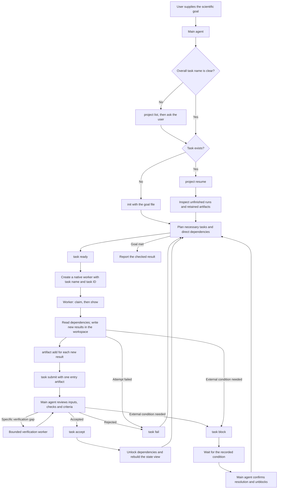

# CANON Agent Rules

CANON's scientific interfaces and method cards are independent of the agent host
and model. Start with [canon-workflow](skills/canon-workflow/SKILL.md) to choose
the next scientific action. Use [docs/agent-workflow.md](docs/agent-workflow.md)
for input preparation and [docs/installation.md](docs/installation.md) for the host capability
contract. Codex-specific setup is in [docs/hosts/codex.md](docs/hosts/codex.md).
Documentation and packaging of selected historical examples do not initiate new
scientific research or require replay.

Call scientific steps through `python3 run_step.py INPUT.json OUTPUT_DIR`.
For a new family, generate physical derivative records through
`PREPARE_DERIVATIVES`, or the parameterization component's automatic `PREPARE`.
Agents supply geometry and kinematics, not hand-written affine operators or
task-local derivative programs. Reuse previously validated derivative artifacts
without replay. A selected replacement provider follows its declared derivative
contract; an unsupported construction is a scoped capability failure.
Carry the task's declared `--components` manifest into each worker assignment
and invocation, and read the selected entry's instructions. See
[component contracts](docs/components.md). Custom component packages replace
named steps without changing their outgoing scientific artifact contracts.
The method choices below describe the default components; an explicitly selected
replacement follows its own documented method and the same acceptance scope.
Packages may declare their own workflow instructions and additional steps.
Read the workflow reported by `--describe` before applying the default route.
Carry the complete ordered component selection; `--defaults` restores built-ins.
Per-step `from` bindings select parameterization, discovery, reduction and DE
providers independently. Native executable/project/export settings belong to
the selected backend, not the parameterization or candidate bridge.
Alternative reconstruction checkers retain their declared evidence scope and do
not inherit the default exact-global-gauge `ALL_PASS` claim.

Use the selected interfaces and existing programs for supported research steps.
Prepare mathematical inputs and JSON configuration; use `PREPARE_REQUEST` for
artifact bindings and `PREPARE_REDUCTION_TARGETS` for symbolic master-derivative
targets. A missing executable capability belongs in a separately scoped component
development task, with its public contract and tests, rather than a task-local
scientific glue program. Keep internal routines small and grouped by responsibility.
Check external inputs at their boundary; avoid repeating checks already guaranteed
by the same call's checked inputs and construction. Preserve the independent
scientific acceptance gates.

For integral-basis discovery from a defined family (UT or canonical), choose a
small, justified proposal from the geometry and current evidence, following
[core selection](skills/canon-search-core/SKILL.md). Simple sectors may need only
dots and natural normalization; Gram constructions address supported numerator,
dimensional or contact-term hypotheses. DlogBasis-refine supplies a general
bounded search when useful, without being a prerequisite for every sector.
Candidate derivative data, including `exact_strategy`, are prepared for the
subsequent IBP bridge. Keep the independent acceptance gates and record which
rank, core or full-prefix result motivates a changed hypothesis. Reuse tested
decision rules only within their recorded scope; a failed finite ansatz does
not exclude other methods.

Before claiming an obstruction, apply the transformation-domain rules in
[core selection](skills/canon-search-core/SKILL.md#scope-of-an-obstruction).
The default rational gauge may be singular at epsilon zero. Use the diagnostic
and bounded residue-balance capability when that failure route applies; do not
infer missing masters or mathematical nonexistence from a failed finite ansatz.

Check completion before selecting methods or creating workers. Matching
FINAL_CHECK `PASS/ALL_PASS` ends scientific work for that scope: submit, review,
accept and deliver. Further scientific work requires an unresolved requested
scope or changed inputs. See the scope and handoff rules in the workflow entry.

## Persistent research access

1. Load `persistent-scientific-research` for multi-step scientific research.
2. The user interacts with the main agent. Never ask the user to operate the
   internal state CLI.
3. Use the project's `statemng` MCP tools for every state operation.
4. Only the main agent may call `statemng_task_accept` or `statemng_task_unblock`.
5. In Codex, dispatch persistent research only through the project's
   `persistent_research_worker` custom agent, restricted to the six worker tools.
   When host-side tool filtering is unavailable, the launcher
   runtime guard must already be bound by the main agent's `init` or `resume`,
   and the worker must verify its restricted role in `task_show` before research.
   Other hosts use native subagents with the same six-tool state boundary; they
   need neither the Codex role name nor its authorization fields.
6. If `statemng` tools are unavailable, stop research and report the integration
   error. Do not bypass state management.
7. Do not use the removed `workflow.py`.
8. The current Codex adapter supports Local sessions. In a Worktree session,
   stop persistent research and report the integration error; do not operate
   another checkout's state directory.
9. Before its first state call, the Codex main agent must run
   `state-management/adapters/codex/install_launcher.py --check`. If it fails,
   install the launcher internally and stop the current research until a new
   Local session loads the MCP configuration. Do not use tools that may point
   to another checkout or ask the user to install it. After a successful check,
   call `init` or `resume` before creating workers to bind the coordinator.

## Distribution and paths

Resolve repository scripts and `external/` source from the current checkout.
Read installed tool entries, executables and thread budgets from task parameters,
the environment or Wolfram configuration. Do not hardcode personal directories
or platform constants. See [README.md](README.md) and
[external/README.md](external/README.md) for configuration fields.

Use `external/DlogBasis-refine` or the caller's declared installation of that
package. Record its declared revision and source hash; the outer CANON Git HEAD
is not the dependency revision.

Distribute external packages as separate source snapshots with their provenance
and licenses. Distribution preparation does not compile dependencies or copy
local binaries, foundation libraries, research run directories or machine-local
launchers. Task descriptions give the required entries, resource budget and path
bases; workers use that installation configuration directly.

Keep development-only records in Git-ignored directories; public documentation
must not depend on them.

## Overall architecture

One local CLI stores independent overall research tasks. The MCP tools expose
that CLI to the coordinator and workers. The host creates and runs subagents;
the state manager records work and does not choose scientific methods.



Every task-scoped call carries the same explicit `task_name`. A task JSON status
of `completed` is the completion fact; dependency readiness and Markdown views
are derived from it.

### Storage and artifact handoff

```text
.state-management/<task-name>/
  meta.json                  Overall goal and schema version
  tasks/T-001.json            Task, dependencies, state and accepted run
  runs/R-001/run.json         Run identity, timing and result
  runs/R-001/workspace/       Writable area for that run
  artifacts/                 Registered immutable result files
  .locks/                    Task-level locks, not research state
  views/PROJECT_STATE.md     Rebuildable state summary
```

An overall task directory is the self-contained unit for recovery or migration.
Individual runs reuse earlier artifacts by reference. There is no shared mutable
scientific state across overall task directories.

- The workspace limits writes. Read the needed dependency artifacts directly at
  `project_root / dependencies[].artifacts[].stored_path` from `task_show`.
  Copy only an input that the tool actually needs to modify.
- List shared input producers and the latest needed result directly in
  `depends_on`. A sector task can depend on the original DE/rules producers and
  the latest accepted prefix; do not pass them through nested historical bundles.
- Register each new or changed result separately. `task_submit` names one entry
  artifact, optionally a short index. Keep unchanged DEs, rules, source, tools and
  historical artifacts under their existing references and registered hashes.
  Do not copy, repack or rescan whole dependency trees.
- A new accepted prefix still contains its complete cumulative transformation,
  basis and matrices, including lower-sector normalization. Do not embed old
  prefix bundles, run workspaces or dependency archives. Extract only needed
  members of existing archives. Full archives are for explicit delivery or
  migration needs.
- Run the existing necessary scientific gates on changed candidates and
  prefixes. Main-agent review checks inputs, checker results and acceptance
  criteria. `CHECK_CORE`, `CHECK_CANONICAL` and `FINAL_CHECK` already provide
  independent mathematical verification. Additional clean replay, candidate
  bridging, IBP or family reruns require a concrete failure, changed input or
  implementation, or a user request.
- Submit, review and accept when the criteria are met. A further verification
  task must name a specific unresolved question. Provenance or packaging alone
  is not a reason to delay accepted scientific progress.

### Coordinator and worker loop

1. Determine one overall task name. Reuse the name already selected by the user.
   If it remains ambiguous, list existing tasks and ask the user to choose.
   Initialize a new task or resume an existing one, then create necessary work.
2. Query ready tasks and dispatch native workers with the overall task name and
   task ID. Supply required skills, input references and the resource budget.
3. Each worker claims and shows its task, reads dependencies in place and writes
   new results in its workspace. It registers new artifacts and submits them,
   or records a concrete failure or external block.
4. The main agent reviews the result. Use a separate verification worker only
   for a specific unresolved issue; that worker submits evidence and never
   accepts the original task.
5. The main agent accepts a result when its criteria are met. Only a completed
   task satisfies dependencies.
6. A blocked task returns to ready only after the main agent confirms the
   recorded external condition has been resolved and calls `unblock`.
7. Continue or revise the plan from accepted evidence. A failed method or ansatz
   is not a proof that the scientific goal is impossible.

For a task explicitly using an optional detached execution component, a worker
may register its immutable job/watch handles and return a `DEFERRED` handoff while
the task remains `running`. This is a host handoff, not an additional task state
or a completed result. The coordinator resumes the same worker, or assigns a
replacement with the existing task ID and run ID after confirming the old worker
is inactive. A resuming worker calls `task_show` for that run without claiming a
new one, checks its worker authorization, and collects the saved job. Submission,
review and acceptance follow only after the requested result is available.
Completion monitors run declared checks and callbacks; they never modify
research state or call `task_accept`/`task_unblock`.

### Task states

```text
pending -> ready -> running -> submitted -> completed
```

| State | Meaning |
|---|---|
| `pending` | Dependencies are not yet completed. |
| `ready` | A worker can claim the task. |
| `running` | A worker has claimed the task and owns the current run. |
| `submitted` | The run awaits main-agent review. |
| `completed` | The main agent accepted the run and its artifacts. |
| `blocked` | A recorded external condition must be resolved. |
| `failed` | The attempt failed without an immediate retry. |

Running or submitted tasks may become blocked. Main-agent `unblock` returns a
blocked task to ready. A failed run with `retryable: true` makes its task ready;
otherwise the task becomes failed. Only the state tools, through the CLI, change
these states.
