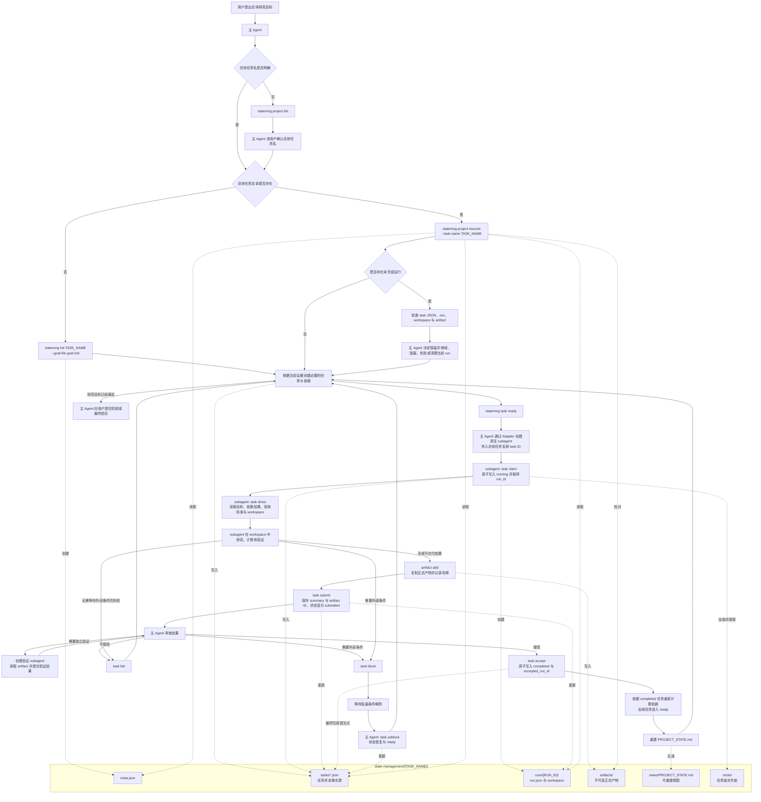

# CANON Agent Rules

## 持续研究接入规则

1. 多步骤科研任务必须加载 `persistent-scientific-research` Skill。
2. 用户只与主 Agent 交互；不得要求用户执行内部 CLI。
3. 所有状态操作必须通过项目提供的 `statemng` MCP tools 完成。
4. `statemng_task_accept` 和 `statemng_task_unblock` 只允许主 Agent 调用，subagent 不得调用。
5. 主 Agent 派发持续研究任务时必须使用 Codex 项目专用的 `persistent_research_worker` custom agent，不得改用未限制 tools 的内置 worker；该 custom agent 的配置必须禁止 `statemng_task_accept` 和 `statemng_task_unblock`。
6. `statemng` tools 不可用时，停止研究并报告接入错误；不得绕过状态管理继续研究。
7. 不得使用已经删除的 `workflow.py`。
8. Codex 初版只允许在 Local 会话中执行持续研究；Worktree 会话必须停止持续研究并报告接入错误，不得操作另一 checkout 的状态目录。
9. Codex 主 Agent 在首次状态调用前必须自行运行 `state-management/adapters/codex/install_launcher.py --check`。校验失败时，由主 Agent 重新安装入口并停止当前持续研究，待全新 Local 会话加载 MCP；不得继续使用可能指向其他 checkout 的 tools，也不得要求用户执行安装命令。

## 四、整体架构

初版只有一个本地 CLI 和按总体任务分隔的状态目录。主 Agent 与原生 subagent 通过 CLI 读写明确指定的总体任务；subagent 的创建和研究过程仍由宿主 Agent 负责，不进入状态管理程序。完整工作流如下：



图中的实线表示研究与调度流程，虚线表示 CLI 对持久化文件的读写。除 `init` 和 `project list` 外，图中每次 CLI 调用都显式携带同一个 `--task-name`，图内不再重复标注。任务 JSON 中的 `completed` 是完成事实；Markdown 视图和依赖解锁结果均可由 JSON 重建。

### 4.1、持久化目录设计

项目内部按总体任务维护独立目录：

```
.state-management/
├── [TASK_NAME_1]/
│   ├── meta.json
│   ├── tasks/
│   │   ├── T-001.json
│   │   └── T-002.json
│   ├── runs/
│   │   └── R-001/
│   │       ├── run.json
│   │       └── workspace/
│   ├── artifacts/
│   │   ├── A-001.md
│   │   └── A-002.json
│   ├── .locks/
│   └── views/
│       └── PROJECT_STATE.md
└── [TASK_NAME_2]/
    └── ...
```

其中：

- `meta.json`：总体任务名称、总体目标的 Markdown 原文和 schema 版本；
- `tasks/*.json`：内部任务、依赖、当前状态和运行结果，是任务状态的事实源；
- `runs/[RUN_ID]/run.json`：单次运行的身份、时间和结果记录；
- `artifacts/`：由 `artifact add` 复制并登记的不可变正式研究产物；
- `runs/[RUN_ID]/workspace/`：每次运行的隔离工作目录；
- `.locks/`：CLI 使用的任务级锁文件，不保存研究状态；
- `views/PROJECT_STATE.md`：由 JSON 生成的当前状态摘要。

每个 `[TASK_NAME]` 目录都是完整、自包含的状态单元，可以独立复制、归档或恢复。`.state-management/` 下不设置跨总体任务共享的可变状态。

### 4.2、主 Agent 与 subagent 的协作闭环

初版不预设固定的研究步骤。主 Agent 根据当前证据创建任务和依赖；新的结果可以促使主 Agent 重新规划尚未开展的研究。

一次协作只包含以下步骤：

1. 主 Agent 确定总体任务名；无法唯一确定时，列出已有名称并请用户确认。总体任务不存在时使用总体目标文件初始化，已经存在时直接恢复；随后创建当前确有必要的任务。
1. 主 Agent 查询 `ready` 任务，创建原生 subagent，并传入总体任务名和内部任务 ID。
1. subagent 依次执行 `claim` 和 `show`，在独立 workspace 中研究；重要结果通过 `artifact add` 保存，然后执行 `submit`，或用 `block`、`fail` 说明无法完成。
1. 主 Agent 读取 summary 和 artifact；必要时另行验证。验证 subagent 只提交验证结果，不接受原任务。
1. 主 Agent 确认结果满足当前任务的验收标准后执行 `accept`。只有进入 `completed` 的任务才能满足后续任务的依赖。
1. 任务进入 `blocked` 后，主 Agent 等待并确认阻塞条件已经解除，再执行 `unblock` 将任务恢复为 `ready`，随后重新派发；subagent 不得解除阻塞。
1. 主 Agent 根据已接受的结果决定继续原计划、创建新的后续任务或停止当前路线。

### 4.3、任务状态模型

初版使用以下状态：

```
pending
   │
   │ 依赖满足
   ▼
 ready
   │
   │ subagent claim
   ▼
 running
   │
   │ subagent submit
   ▼
submitted
   │
   │ main Agent accept
   ▼
completed
```

`running` 或 `submitted` 也可以转为 `blocked`；阻塞条件解除后，主 Agent 通过 `unblock` 将任务重新转为 `ready`。运行失败时，`retryable: true` 使任务重新转为 `ready`，否则任务进入 `failed`。

状态含义：

- `pending`：前置依赖尚未完成；
- `ready`：可以被 subagent 领取；
- `running`：已经由某个 subagent 领取；
- `submitted`：subagent 已提交结果，等待主 Agent 验收；
- `completed`：主 Agent 已接受结果，任务正式完成；
- `blocked`：需要用户、主 Agent 或外部条件介入；条件解除后由主 Agent 恢复为 `ready`；
- `failed`：本次执行失败，且没有进入下一次重试；


只有 CLI 可以修改任务状态。
