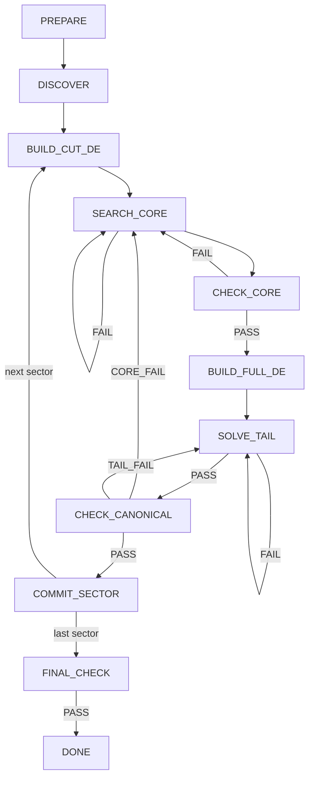

# CANON_neu 架构

## 目标

CANON_neu 只保留一个状态机：`workflow.py`。它是供 AI agent 查询和更新的任务看板，不是科学计算程序。

状态机只负责：

- 维护当前阶段、sector 顺序、任务状态和 artifact 路径；
- 向主 agent 发出一个明确的当前任务包；
- 在指定任务上强制主 agent 调派 subagent；
- 接收标准化 `result.json`，按固定表推进或回环；
- 保留全部任务历史。

每一个科学步骤都由 agent 显式运行预先准备的无状态 Mathematica 脚本：

```text
wolframscript -file <script.wls> <input.json> <output_dir>
```

脚本读取一个 JSON，写出 `<output_dir>/result.json` 和若干不透明 artifact。当前阶段的 `.wls` 全部只是接口模板，没有科学实现。

## 唯一控制流



`DISCOVER` 报告每个 sector 的 `id` 和 `propagator_count`。Python 只按
`(propagator_count, id)` 排序，不从 propagator 或 Mathematica 表达式推导这些值。

未画出的 `ERROR` 和没有固定恢复路径的 `FAIL` 会把 workflow 标记为 `BLOCKED`。状态机不猜测科学恢复策略。

## Agent 交互

任意时刻只有一个主任务：

```text
READY -> RUNNING -> DONE
                  -> BLOCKED
```

典型交互是：

1. 主 agent 用 `status` 或 `next` 查询看板和动态生成的任务包；任务包明确给出
   当前步骤的 `SKILL.md`、脚本、输入和输出位置。
2. 主 agent 用 `start` 领取任务。
3. 如果任务要求 delegation，主 agent 用 `delegate` 指定 subagent、角色和脚本。
4. subagent 运行被指定的脚本，只写标准 `script-result/v1`；它不写 `state.json`。
5. 主 agent 用 `subreport` 登记这个标准脚本结果。
6. 主 agent 可以直接采用同一个结果，再用 `report` 提交；也可以在汇总其他
   路线后提交另一个符合相同协议的结果。
7. `workflow.py` 创建下一个任务，或创建同一阶段的新 attempt。

当前仅 `SEARCH_CORE` 强制一个 `candidate_route` subagent。这样足以实现并验证 delegation gate，而不把每一步都复杂化。未完成该角色的 subreport 时，主任务不能提交。

## 数据边界

状态机理解的科学数据只有：

- sector 的 `id` 与 `propagator_count`；
- artifact 的逻辑名、类型和文件路径；
- `PASS | FAIL | ERROR`；
- `CHECK_CANONICAL/FAIL` 的 `CORE_FAIL | TAIL_FAIL` 路由码。

以下内容永远不进入 Python：

- Mathematica、Kira、Blade 或其他 provider 的启动和进程管理；
- `.wl` 表达式解析；
- IBP、DE、leading singularity、Gram/Baikov、ansatz 和规范变换计算；
- UT 或 canonical 判定；
- DlogBasis、Gram-Baikov 或 MethodCard 的科学选择；
- Mathematica kernel、notebook 或 session 状态。

## 文件协议

每个任务目录只有三个固定位置：

```text
runs/<run-id>/tasks/<task-id>/
├── input.json      # 对应 .wls 的标准输入
└── output/
    └── result.json # .wls 的标准结果
```

`next` 直接从 `state.json` 生成任务包，不额外保存副本。`state.json`
是唯一真相源，只有协调主 agent 通过 `workflow.py` 修改它。实现没有数据库、
Web UI、DAG、锁服务、自动重试、checkpoint/replay 或旧 CANON 兼容层。

## 目录

```text
CANON_neu/
├── workflow.py
├── ARCHITECTURE.md
├── INTERFACES.md
├── README.md
├── project.example.json
├── interfaces/
├── skills/               # 每个 workflow step 的空白 agent SKILL
├── mma/
├── methods/
│   ├── dlogbasis/
│   ├── gram-baikov/
│   └── method-card-template/
└── tests/
```

旧 CANON 只提供过概念参考；本目录不导入、迁移或兼容它的代码和状态。
