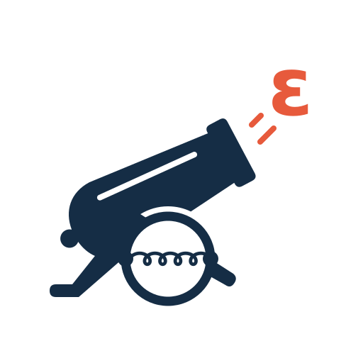

<picture>
  <source media="(prefers-color-scheme: dark)" srcset="assets/branding/canon/candidate-b-gluon-axle/canon-icon-reverse.svg">
  
</picture>

# CANON

[Chinese (Simplified)](README.zh-CN.md)

CANON uses an AI agent to find a canonical basis for a family of Feynman integrals.
Given a vector of master integrals $I$, it searches for a change of basis $J=T^{-1}I$ such that

$$
\mathrm{d}J = \epsilon \left(\sum_a R_a\,\mathrm{d}\log W_a\right) J .
$$

The letters $W_a$ depend on the kinematics, the residue matrices $R_a$ are constant,
and $\epsilon$ is the dimensional regulator. Given boundary values, this equation can
be integrated order by order in $\epsilon$.

CANON works sector by sector. A basis that works within one sector may need to
change when integrals with fewer propagators are included. The agent can try
different integral numerators or transform the differential equations directly.
Independent algebra programs substitute the resulting transformation into the original
equations and check the identity for every kinematic variable.

## Read the results from the paper

The repository includes the canonical basis, alphabet and logarithmic matrix for
each of the three examples in the paper. You can read them directly in Wolfram Language.

| Integral family | Master integrals | Sectors | Kinematic variables | Active letters |
| --- | ---: | ---: | ---: | ---: |
| [Off-shell double box with one internal mass](examples/double-box/) | 37 | 24 | 5 | 21 |
| [Massless two-loop five-point pentabox](examples/pentabox/) | 61 | 46 | 5 | 24 |
| [Three-loop family](examples/three-loop/) | 40 | 28 | 2 | 3 |

```sh
git clone https://github.com/Alice-Shimada/CANON-release.git
cd CANON-release
```

For example, open a fresh Wolfram session in the repository root and load the three-loop result.

```wl
basis = Get["examples/three-loop/canonical-basis.wl"];
letters = Get["examples/three-loop/alphabet.wl"];
aTilde = Get["examples/three-loop/Atilde.wl"];

{Length[basis], letters, Dimensions[aTilde]}
(* {40, {s, u, 1 - u}, {40, 40}} *)

Coefficient[aTilde, Log[W[1]]] === -3 IdentityMatrix[Length[basis]]
(* True *)
```

The file `Atilde.wl` stores $\sum_a R_a \log W_a$. Here `W[1]` is $s$, and the
coefficient of its logarithm is $-3$ times the identity. At fixed $u$, each basis
integral therefore obeys $s\,\partial_s J_i=-3\epsilon J_i$. For the propagator
order and normalization of each family, see the [example notes](examples/README.md).

## Run CANON on an integral family

The default setup uses Python 3.10+ and Wolfram Language with `wolframscript`.
For integration-by-parts (IBP) reduction, configure a reducer such as Kira.
To use the supplied Codex integration, open the checkout in a Local session and
follow the setup guide. CANON saves completed sectors so you can resume later. [Installation](docs/installation.md) · [Codex setup](docs/hosts/codex.md)

For a first run, give the agent the prepared one-loop triangle example. Sector 5 has two active propagators.

> Find a canonical basis for sector 5 of the triangle family in `interfaces/prepare.example.json`.
> Call the task `triangle-sector-5-example`. Use the supplied master `tri[1,0,1]` in `d = 2 - 2 eps`.
> Use one reducer thread for up to 30 minutes. Return the PDF report. If the basis and equation pass the checks, include them too.

For your own family, specify the propagators, kinematics, dimension, sectors of
interest and computing budget. If you already have differential equations, supply
the matrices together with the order of the master integrals and variables. [Input guide](docs/agent-workflow.md#what-to-provide) · [Available methods](methods/README.md)

You can also call individual steps from the command line with
`python3 run_step.py INPUT.json OUTPUT_DIR`. [Step interfaces](INTERFACES.md#common-invocation)

A successful calculation writes `canonical-basis.wl` with the basis and its
transformation, and `canonical-de.wl` with the equation matrices, alphabet and
residues. [Output files](docs/results.md)

The agent returns a PDF even when some sectors remain unresolved. The report gives each
sector its own entry covering the methods tried, the choice and normalization of
the integrals, and which checks passed. It cites the GitHub repository or a
primary paper for every method and package used. [Report requirements](skills/canon-workflow/SKILL.md#export-the-final-pdf-report)

## Authors and citation

Dongshan Jian, Yuanche Liu, Yanqing Ma, Boxuan Shi, Yu Wu, Zihao Wu and Yang Zhang.

When citing CANON, include the version or commit you used. [Software citation](CITATION.cff) · [Method references](CREDITS.md)

CANON is distributed under the MIT license. Bundled external packages carry their own licenses. [CANON license](LICENSE) · [External packages](external/README.md)
