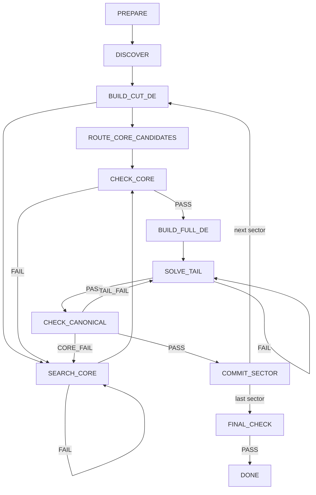

# Historical CANON_neu architecture (retired)

> This file preserves the intent of an early scientific pipeline design. It does
> not describe current state permissions, agent handoffs, or an executable
> coordinator. The `workflow.py`, `state.json`, `delegate`, `subreport`, and single
> legacy control flow below are retired; do not restore them or cite them as
> current facts. The only current persistent-research state protocol is the
> `statemng` protocol in the root `AGENTS.md` and `README.md`. For active scientific
> work, follow [the current agent workflow](../agent-workflow.md) and current skills.

## Goal

CANON_neu retains only one state machine: `workflow.py`. It is a task board for AI
agents to query and update, not a scientific computation program.

The state machine is responsible only for:

- Maintaining the current stage, sector order, task status, and artifact paths;
- Issuing one explicit current task package to the main agent;
- Requiring the main agent to delegate to a subagent for specified tasks;
- Receiving standardized `result.json` files and advancing or looping according to a fixed table;
- Retaining the complete task history.

For every scientific step, the agent explicitly runs a prepared, stateless
Mathematica script:

```text
wolframscript -file <script.wls> <input.json> <output_dir>
```

The script reads one JSON file and writes `<output_dir>/result.json` plus opaque
artifacts. At this stage, all `.wls` files are interface templates without
scientific implementations.

## Single control flow



`DISCOVER` reports each sector's `id` and `propagator_count`. Python sorts only by
`(propagator_count, id)`; it does not derive these values from propagators or
Mathematica expressions.

An `ERROR`, or a `FAIL` without a fixed recovery path, marks the workflow as
`BLOCKED`; these cases are omitted from the diagram. The state machine does not
infer a scientific recovery strategy.

## Agent interaction

There is only one main task at any time:

```text
READY -> RUNNING -> DONE
                  -> BLOCKED
```

A typical interaction is:

1. The main agent uses `status` or `next` to query the board and dynamically
   generated task package. The package explicitly identifies the current step's
   `SKILL.md`, script, input, and output locations.
2. The main agent claims the task with `start`.
3. If delegation is required, the main agent uses `delegate` to specify the
   subagent, role, and script.
4. The subagent runs the assigned script and writes only a standard
   `script-result/v1`; it does not write `state.json`.
5. The main agent registers this standard script result with `subreport`.
6. The main agent may adopt the same result and submit it with `report`, or
   combine findings from other routes and submit another result under the same
   protocol.
7. `workflow.py` creates the next task or a new attempt at the same stage.

At this stage, only `SEARCH_CORE` requires a `candidate_route` subagent. This is
sufficient to implement and verify the delegation gate without complicating
every step. The main task cannot be submitted until that role's subreport is complete.

## Data boundary

The only scientific data understood by the state machine are:

- A sector's `id` and `propagator_count`;
- An artifact's logical name, type, and file path;
- `PASS | FAIL | ERROR`;
- The `CORE_FAIL | TAIL_FAIL` routing codes for `CHECK_CANONICAL/FAIL`.

The following never enter Python:

- Launching and managing Mathematica, Kira, Blade, or other provider processes;
- Parsing `.wl` expressions;
- IBP, DE, leading-singularity, Gram/Baikov, ansatz, and gauge-transformation calculations;
- UT or canonical-form decisions;
- Scientific selection of DlogBasis-refine or a MethodCard;
- Mathematica kernel, notebook, or session state.

## File protocol

Each task directory has only three fixed locations:

```text
runs/<run-id>/tasks/<task-id>/
├── input.json      # Standard input for the corresponding .wls
└── output/
    └── result.json # Standard result from the .wls
```

`next` generates a task package directly from `state.json` without storing another
copy. `state.json` is the sole source of truth, modified only by the coordinating
main agent through `workflow.py`. The implementation has no database, Web UI, DAG,
lock service, automatic retries, checkpoint/replay, or compatibility layer for
legacy CANON.

## Directories

```text
CANON_neu/
├── workflow.py
├── ARCHITECTURE.md
├── INTERFACES.md
├── README.md
├── project.example.json
├── interfaces/
├── skills/               # Empty agent SKILL for each workflow step
├── mma/
├── methods/
│   ├── dlogbasis/
│   └── method-card-template/
└── tests/
```

Legacy CANON provided conceptual references only. This directory does not import,
migrate, or provide compatibility with its code or state.

# IBP/DE scientific components at the time of this record

This section describes the stateless scientific components recorded here; it does
not restore the historical coordinator above. Persistent-research tasks, runs,
workspaces, and artifacts remain managed by `statemng` as specified in the root
`AGENTS.md` and `README.md`. Scientific programs neither know task IDs nor modify
`.state-management/`.

```text
collaborator preparation
  -> ordered masters + declared propagator slots + derivative operators
  -> raw-master derivative targets -> Kira reduction/export
  -> DEBuilder -> ordered DE (reused for every sector)
  -> CANONICA/Libra core transformation
     or optional DlogBasis-refine candidates -> IBP -> reduced row-basis selection
  -> full-prefix embedding -> off-diagonal solve + epsilon normalization
  -> canonical check -> cumulative commit -> next sector -> final shared residues
```

- `mma/PrepareFamily.wls` directly binds production family/Kira inputs from a trusted typed family-spec;
- `mma/lib/BaikovDerivative.wl` provides a bounded exact zero-growth search and affine fallback;
- `mma/lib/CandidateIBPBridge.wl` converts current `j[family,inds]` candidates and the complete Baikov measure cofactor formula into exact targets with sector/numerator metadata;
- `mma/ReduceIBP.wls` runs only the two Kira jobs specified in the request and delivers masters and rules;
- `mma/lib/DEBuilder.wl` consumes only in-memory mathematical objects and delivers matrices and validity.

`canon-neu/candidate-ibp-bridge/v1` establishes only bounded IBP closure of the
listed targets on the frozen masters. A cofactor search or reduction PASS must
not be presented as a UT/canonical result. The DE uses the column-vector convention
`D[I,x] == A_x.I`. Curvature is checked at only one deterministic exact rational
point; a PASS there must not be extrapolated to global flatness.

The released code does not retain usernames, home paths, a fixed Kira location,
live-run logs, databases, rules, or matrix results. Frozen fixtures and offline
tests are reusable input contracts. A real Kira pentabox run is always explicitly
opt-in and runs in a fresh workspace ignored by Git.
