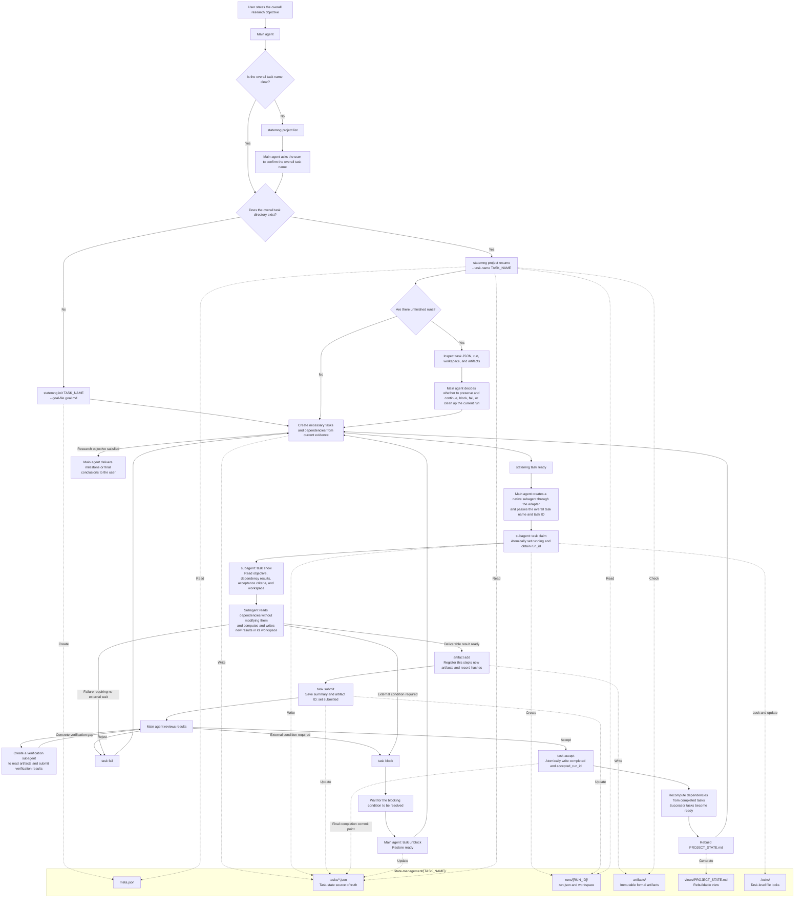

# Design for persistent-research state-management infrastructure across general-purpose agents

> Historical scope: this document preserves the original infrastructure design
> and its proposed operating rules. For active work, follow
> [the current agent workflow](../agent-workflow.md),
> [installation guide](../installation.md), and current skills. Historical commands
> and design requirements below do not establish current host support.

---

Constructing an $\epsilon$-form is not a linear process. A single example commonly
requires many related asynchronous tasks and repeated exploration, verification,
and backtracking among methods and candidates. Task dependencies must be obeyed,
and each attempt's successful approaches, failure reasons, and intermediate
results must be preserved for later decisions and reuse. A single Markdown
document is useful for presenting research records, but cannot reliably manage
concurrent claiming, dependency unlocking, and state transitions, or ensure that
different sessions and agents always use the same valid facts. This design
therefore uses JSON data in task directories and a controlled CLI to manage task
state and research history, with Markdown as a readable view, providing a reliable
state-management foundation for persistent research.

**Document version:** v0.1
**System purpose:** Persistent-research infrastructure for general-purpose agents such as Codex, Hermes, and Claude Code
**Core form:** Internal CLI + file storage isolated by overall task + platform adapters
**Core constraints:**

1. Users interact only with a main agent such as Codex, Hermes, or Claude Code;
1. The CLI is an internal collaboration interface for the main agent and subagents, not a user-facing interface;
1. All subagents are created through the current host agent's native mechanism; the system itself starts no additional agent processes;
1. All persistent state and research artifacts reside in the project's `.state-management/[TASK_NAME]/`;
1. Project state is independent of any particular agent session.

In CANON, implementing this design will completely replace the current demo
state machine. Existing `workflow.py` and `state.json` are not targets for
compatibility or migration.

## 1. Project goals

This system provides different general-purpose agents with a shared mechanism
for persistent research, enabling them to:

- Break complex research objectives into long-term tasks;
- Execute subtasks in parallel using their native subagents;
- **Preserve research progress across sessions**;
- **Manage dependencies, blockers, and result handoffs**;
- Accumulate research evidence, decisions, and artifacts;
- Preserve successful and failed approaches and intermediate results for later tasks to reuse;
- Continue the same project after switching among Codex, Hermes, and Claude Code.

The first version implements only the state loop and minimum recovery requirements
explicitly defined here. Add new fields, commands, or automation only when actual
research tests expose a concrete problem, with corresponding tests. Do not
preemptively add mechanisms for scenarios that have not occurred.

## 2. Core system model

The whole system can be summarized as:

> The main agent plans and schedules, native subagents execute, and the CLI and
> JSON files in task directories preserve and constrain shared state.

Specifically:

- Users need to interact only with the main agent;
- The main agent is the research lead and task scheduler;
- Subagents are temporary research executors;
- The CLI is the command set and task protocol shared by all agents;
- JSON, Markdown, and research artifacts in `.state-management/[TASK_NAME]/` preserve the overall task's long-term state.

## 3. Core design principles

### 3.1 Models conduct research; programs enforce order

Agents are responsible for:

- Understanding and decomposing research problems;
- Proposing hypotheses, designing checks, and analyzing results;
- Deciding the next research direction and action.

The CLI and underlying program are responsible for:

- Persisting task state, run history, and research artifacts;
- Checking dependencies and ensuring that task claims and state transitions are valid.

The system cannot rely only on prompts asking agents to remember to update
progress. Critical state must be changed through the CLI.

### 3.2 The CLI does not create subagents

The CLI manages tasks only; it does not directly start or control subagents.

Task assignment has two levels.

#### Logical assignment

The CLI records task claiming and execution:

```
statemng task claim T-012 \
  --task-name [TASK_NAME]
```

#### Physical assignment

The main agent uses its native capability to create a subagent and gives it the
overall task name and internal task ID.

Thus:

> The CLI manages task runs; the main agent decides which subagent to create to
> execute a task.

### 3.3 A shared protocol, not a shared internal implementation

Different agents may create subagents differently:

```
Codex Adapter
Claude Code Adapter
Hermes Adapter
```

Once created, every subagent follows the same protocol:

```
Claim task
→ Read task
→ Execute task
→ Register artifacts
→ Submit results, or report blockers and failures
```

The main agent decides whether results satisfy acceptance. Platform differences
are confined to how native subagents are created and do not enter the core task
system.

### 3.4 Markdown for reading, JSON for operation

The system generates `views/PROJECT_STATE.md` inside each overall task directory
for quick reading by humans and agents. Runtime state is stored in JSON files;
Markdown is generated or updated only from JSON state.

The principle is:

> JSON is the source of truth; Markdown is a human-readable projection.

This preserves transparency while preventing conflicts from concurrent edits to
the same progress document by multiple agents. The current version targets
individual scientific research and does not introduce SQL.

### 3.5 Isolation by overall task

After project initialization, all state-management outputs must reside in:

```
.state-management/[TASK_NAME]/
```

Here, `[TASK_NAME]` identifies the overall research task that needs long-term
management. It is subdivided internally into task units such as `T-001` and
`T-002`. Different overall tasks use independent sibling directories and share
no mutable state. For an $\epsilon$-form project, an overall task may correspond
to an integral family, with directory `.state-management/[FAMILY_NAME]/`.

The overall task name must itself be a valid directory name, contain no path
separators, and be neither `.` nor `..`. The CLI does not implicitly rewrite names,
ensuring that the directory name matches the task name.

Except for `init` and read-only `project list`, every command must specify exactly
one overall task through `--task-name`. The system stores no project-level
current overall task and does not select one automatically from context,
prompts, or approximate names. The CLI must verify that `.state-management/` lies
inside the current project and is not a symbolic link, and that the overall task
directory is its direct child and is not a symbolic link. Reject every path
escape. Once resolved, all state reads and writes for that command must remain
within the specified overall task directory.

## 4. Overall architecture

The first version has only one local CLI and state directories separated by
overall task. The main agent and native subagents use the CLI to read and write
an explicitly specified overall task. Subagent creation and research execution
remain the host agent's responsibility and do not enter the state-management
program. The complete workflow is:



Solid lines show research and scheduling flow; dashed lines show CLI reads and
writes to persistent files. Except for `init` and `project list`, every CLI call
in the diagram explicitly carries the same `--task-name`, omitted from repeated
labels for brevity. `completed` in task JSON is the fact of completion. Markdown
views and dependency-unlocking results can be rebuilt from JSON.

### 4.1 Persistent directory design

Maintain independent directories for overall tasks inside the project:

```
.state-management/
├── [TASK_NAME_1]/
│   ├── meta.json
│   ├── tasks/
│   │   ├── T-001.json
│   │   └── T-002.json
│   ├── runs/
│   │   └── R-001/
│   │       ├── run.json
│   │       └── workspace/
│   ├── artifacts/
│   │   ├── A-001.md
│   │   └── A-002.json
│   ├── .locks/
│   └── views/
│       └── PROJECT_STATE.md
└── [TASK_NAME_2]/
    └── ...
```

Contents:

- `meta.json`: overall task name, the overall objective's original Markdown text, and schema version;
- `tasks/*.json`: internal tasks, dependencies, current state, and run results; the source of truth for task state;
- `runs/[RUN_ID]/run.json`: identity, timestamps, and result record for one run;
- `artifacts/`: immutable formal research artifacts copied and registered by `artifact add`;
- `runs/[RUN_ID]/workspace/`: isolated working directory for each run;
- `.locks/`: task-level lock files used by the CLI, storing no research state;
- `views/PROJECT_STATE.md`: current-state summary generated from JSON.

Each `[TASK_NAME]` directory is a complete, self-contained state unit that can be
copied, archived, or restored independently. The unit of self-containment is the
overall task directory, not each run or sector. Later artifacts reuse earlier
formal artifacts by reference. No mutable state is shared across overall tasks
under `.state-management/`.

Artifact handoff and acceptance follow these rules:

- The workspace restricts write locations. Workers directly read the supplied dependency files without modifying them. `task_show` returns registered accepted-run records in `dependencies[].artifacts`, with paths `project_root / stored_path`. If a tool truly requires writable input, copy only the files that this step must change.
- The main agent directly lists the producers of shared inputs and the latest required result tasks in `depends_on`. For example, sector-by-sector tasks depend on the producers of the raw DE and pooled rules, plus the latest accepted prefix; these inputs are not passed through nested historical packages.
- Register each new artifact file separately with `artifact add`; `task_submit` selects one entry artifact, which may be a short file index for a multi-file delivery. Register only this step's new or changed results. Existing DEs, rules, source, tools, and historical artifacts retain their original references and registered hashes; do not recopy, repackage, or fully scan their dependency trees.
- A new accepted prefix must still preserve the complete cumulative transformation, basis, and matrices, including lower-sector normalization; storage savings do not change scientific interfaces. Do not embed an old prefix's full artifact package, run workspace, or dependency package in a new artifact. Extract only required members of existing compressed dependencies; full archives are reserved for explicit delivery or migration needs.
- Run the existing required scientific gates for new candidates and prefixes. The main reviewer checks current inputs, checker results, and acceptance criteria; the independent checks in `CHECK_CORE`, `CHECK_CANONICAL`, and `FINAL_CHECK` already constitute scientific verification. Without a concrete failure, changed input or implementation, or a user request, do not add a second clean replay, repeat the candidate bridge or IBP, or recompute the entire family.
- Submit, review, and accept once acceptance criteria are satisfied. Additional verification tasks must identify a specific unresolved question; do not delay progress solely for provenance, packaging, or formal completeness.

### 4.2 Main-agent/subagent collaboration loop

The first version does not prescribe fixed research steps. The main agent creates
tasks and dependencies from current evidence; new results may prompt replanning
of work that has not yet begun.

A collaboration consists only of these steps:

1. The main agent determines the overall task name; if it is not unique, list existing names and ask the user to confirm. Initialize a nonexistent overall task from an objective file, or directly resume an existing one, then create only tasks currently needed.
1. The main agent queries `ready` tasks, creates native subagents, and passes each the overall task name and internal task ID.
1. A subagent calls `claim` then `show`, reads dependency files directly without modifying them, and writes new results in its isolated workspace. It saves new artifacts through `artifact add`, then calls `submit`, or explains why it cannot finish through `block` or `fail`.
1. The main agent reads the summary, checker results, and artifacts. Perform additional verification only for specific unresolved questions. Verification subagents submit verification results and do not accept the original task.
1. The main agent calls `accept` after confirming that the result meets the current task's acceptance criteria. Only a `completed` task satisfies later dependencies.
1. After a task becomes `blocked`, the main agent waits and confirms that its blocking condition has been resolved, calls `unblock` to restore `ready`, and redispatches it. Subagents may not unblock tasks.
1. The main agent uses accepted results to decide whether to continue the original plan, create new follow-up tasks, or stop the current route.

### 4.3 Task state model

The first version uses these states:

```
pending
   │
   │ Dependencies satisfied
   ▼
 ready
   │
   │ subagent claim
   ▼
 running
   │
   │ subagent submit
   ▼
submitted
   │
   │ main Agent accept
   ▼
completed
```

`running` or `submitted` may also become `blocked`. Once the blocking condition is
resolved, the main agent returns the task to `ready` with `unblock`. On run failure,
`retryable: true` returns the task to `ready`; otherwise it becomes `failed`.

State meanings:

- `pending`: prerequisites have not completed;
- `ready`: a subagent may claim the task;
- `running`: a subagent has claimed the task;
- `submitted`: a subagent has submitted results, awaiting main-agent acceptance;
- `completed`: the main agent has accepted the result; the task is formally complete;
- `blocked`: user, main-agent, or external intervention is needed; the main agent restores `ready` once the condition is resolved;
- `failed`: this execution failed and has not entered another retry.

Only the CLI may modify task state.

## 5. Main components

### 5.1 Main agent

The main agent is the host agent itself. For this system, only its responsibilities
need to be defined; it needs no separate implementation.

The main agent is the system's research lead.

Its primary responsibilities are:

- Receive the user's objective, read project state, and plan the research;
- List existing overall task names and ask the user to confirm when the name is not unambiguous;
- Create tasks and dependencies and select work that can proceed in parallel;
- Create native subagents and pass the overall task name and internal task ID;
- Review submitted results, obtain independent verification if needed, and decide whether to accept them;
- Inspect execution state, handle blockers and failures, and organize result synthesis;
- Report milestone results to the user.

The main agent should neither personally execute all subtasks nor keep all
project state only in its own context.

### 5.2 Native subagents

Only the host agent's native mechanism may create subagents. For this system,
only their responsibilities need to be defined; no separate implementation is
needed.

Each subagent's responsibility should be as focused as possible:

- Research review or theoretical analysis;
- Code implementation or experiment execution;
- Data analysis or result review.

At startup, each subagent needs only:

- The overall task name;
- The internal task ID;
- The CLI usage protocol.

The subagent obtains detailed task background through the CLI itself. It submits
research results but may not execute `accept` or `unblock`, set a task to
`completed`, or remove a blocker itself.

### 5.3 Platform adapter

Adapters neither schedule tasks nor start external processes.

They only describe how the current platform uses its native subagents.

For example:

```
adapters/
├── codex/
│   └── ADAPTER.md
├── hermes/
│   └── ADAPTER.md
└── claude-code/
    └── ADAPTER.md
```

Each adapter should specify:

1. How to create native subagents and pass the overall task name and internal task ID;
1. How to execute in parallel and limit maximum concurrency;
1. How to determine that a subagent has finished and handle abnormal exits;
1. How to ensure that only the main agent calls `accept` and `unblock`, and prohibit subagents from using the corresponding tools.

Keep adapters as thin as possible, without storing project state.

### 5.4 State Management CLI

The CLI is the system's internal control interface.

It serves the main agent and native subagents, not users directly. The command
name is consistently `statemng`, returning JSON by default. `ok` indicates only
whether that command executed successfully, not whether the task is complete.
Task state may be changed only through the CLI.

## 6. CLI command design

The first version implements only the commands below.

`statemng init` uses the invocation's working directory as the project root.
Other commands search upward from the invocation location for the nearest
project-level `.state-management/` and stop if none is found. The CLI uses the
invocation location only to identify the project; it does not change the main
agent's or subagent's working directory.

Except for `init` and `project list`, all commands must explicitly provide
`--task-name [TASK_NAME]`. A missing argument returns `TASK_NAME_REQUIRED`; a
nonexistent name returns `TASK_NOT_FOUND`. Neither case may modify files. After
successful task-name resolution, every response includes the actual `task_name`
used.

### 6.1 Initialize a project

```
statemng init [TASK_NAME] \
  --goal-file goal.md
```

Responsibilities:

- Create `.state-management/[TASK_NAME]/`;
- Initialize JSON state files and artifact and run directories;
- Read the overall objective file and store its original Markdown text in the `goal` field of `meta.json`;
- Write the schema version and overall task name;
- Generate the initial Markdown state view.

`--goal-file` must point to an existing, nonempty UTF-8 Markdown file. The file
is initialization input only; the CLI neither stores its path nor copies it
separately. After initialization, `goal` in `meta.json` is the source of truth for
the overall objective. Later edits to the external file do not affect the
initialized overall task. The first version provides no command for changing
the overall objective.

If the objective file is invalid or an overall task directory with the same name
already exists, the command must stop without modifying files. Initialization
does not change the main agent's working directory.

Response:

```
{
  "ok": true,
  "task_name": "[TASK_NAME]",
  "task_root": "/path/to/project/.state-management/[TASK_NAME]",
  "schema_version": 1
}
```

### 6.2 List and resume overall tasks

```
statemng project list --json
```

This command lists only existing overall task names in the current project,
without reading or modifying their internal state:

```
{
  "ok": true,
  "task_names": ["TASK-A", "TASK-B"]
}
```

If `.state-management/` does not yet exist, return an empty list rather than an error.

When the user explicitly supplies an overall task name, the main agent uses it
directly. When the user explicitly requests a new task with that name, the main
agent prepares the overall objective file and calls `init`. If no overall task
exists and the user has supplied no name, the main agent proposes a name and
asks the user to confirm. If the name is unclear and multiple overall tasks
exist, or the name to resume does not exist, the main agent presents existing
names for user confirmation. Do not guess, rename, or create a task independently.
The CLI does not simulate user confirmation; it only stops if the task name is
missing or invalid.

```
statemng project resume \
  --task-name [TASK_NAME] \
  --json
```

The main agent calls this at the start of each new session.

The response should include:

- The project objective;
- Each task's current state;
- Submitted results and unfinished runs.

Return compact project state, not the entire history.

### 6.3 Create a task

```
statemng task create \
  --task-name [TASK_NAME] \
  --title "Review related research" \
  --description-file task.json \
  --depends-on T-001,T-002 \
  --json
```

The format of `task.json` is:

```json
{
  "objective": "[Objective]",
  "background": "[Background, e.g. xxx has already been completed, ...]",
  "acceptance_criteria": [
    "[Define appropriate acceptance criteria]"
  ],
  "required_skills": [
    "methods/libra/SKILL.md"
  ]
}
```

`objective` must be a nonempty string; `background` must be a string and may be
empty when there is no additional context; `acceptance_criteria` must be an array
containing at least one nonempty string. `required_skills` is an optional string
array; each entry must be a repository-relative path to an existing `SKILL.md`.
Absolute paths, `..`, other filenames, missing files, and duplicate paths are
forbidden. Older task descriptions omitting this field remain compatible. No
other fields are allowed. This file is task-creation input only: the CLI writes
these fields into task JSON without storing the original file path, and later
state does not depend on the description file.

Design requirements:

- Automatically generate a stable task ID;
- Validate and save the objective, background, dependencies, acceptance criteria, and optional required skills;
- Stop without creating a task if the JSON description is invalid.

Response:

```
{
  "ok": true,
  "task_name": "[TASK_NAME]",
  "task_id": "T-012",
  "status": "pending",
  "dependencies": ["T-001", "T-002"],
  "required_skills": ["methods/libra/SKILL.md"]
}
```

Once all dependencies are complete, the system automatically changes the task
to `ready`.

### 6.4 Query executable tasks

```
statemng task ready \
  --task-name [TASK_NAME] \
  --json
```

The main agent uses this to decide which subagents to create.

Keep the response concise:

```
{
  "task_name": "[TASK_NAME]",
  "tasks": [
    {
      "task_id": "T-012",
      "title": "Review related research"
    }
  ]
}
```

### 6.5 Claim a task

> **Note (not implemented in this version):** A future version could impose a
> concurrency limit at `claim`: once the current overall task reaches its limit
> of `running` tasks, `statemng` rejects further claims, indirectly limiting the
> number of subagents entering execution simultaneously. This cannot limit the
> total number of subagents already created by the host; creation-side concurrency
> remains controlled by the main agent and adapter. Implementation would also
> require separate designs for atomic concurrency checks, handling rejected
> claims, and recovering capacity when abnormal exits leave tasks `running`.
> This version defines no related parameters or protocol.

```
statemng task claim T-012 \
  --task-name [TASK_NAME] \
  --json
```

This is usually a subagent's first call after startup.

Responsibilities:

- Atomically check that the task is `ready`;
- Prevent duplicate claims by multiple subagents;
- Set the task to `running`;
- Create a unique `run_id`;
- Record the claim time.

Response:

```
{
  "ok": true,
  "task_name": "[TASK_NAME]",
  "task_id": "T-012",
  "run_id": "R-048",
  "status": "running"
}
```

If the task has already been claimed:

```
{
  "ok": false,
  "task_name": "[TASK_NAME]",
  "error": "TASK_ALREADY_CLAIMED"
}
```

### 6.6 Read a task

```
statemng task show T-012 \
  --task-name [TASK_NAME] \
  --run-id R-048 \
  --json
```

Return:

- Task objective, background, and acceptance criteria;
- Required skills, if any, to read completely before research;
- Prerequisite results and related artifacts;
- The current run's working directory.

This avoids requiring the main agent to copy the entire context when creating
a subagent.

After `claim` and `show`, and before starting research, the subagent must completely
read each `required_skills` path in the returned order. If the field is absent
or empty, no additional skill is required.

### 6.7 Register an artifact

```
statemng artifact add \
  --task-name [TASK_NAME] \
  --task T-012 \
  --run-id R-048 \
  --path runs/R-048/workspace/literature-review.md \
  --json
```

Responsibilities:

- Verify that the file exists;
- Compute its content hash;
- Store its source task and run IDs;
- Copy the file into the common artifact directory;
- Keep the registered formal artifact immutable;
- Return an artifact ID.

Response:

```
{
  "ok": true,
  "task_name": "[TASK_NAME]",
  "artifact_id": "A-031",
  "stored_path": ".state-management/[TASK_NAME]/artifacts/A-031.md"
}
```

Important task results must not exist only in a subagent's chat response.

### 6.8 Submit task results

```
statemng task submit T-012 \
  --task-name [TASK_NAME] \
  --run-id R-048 \
  --summary-file runs/R-048/workspace/summary.md \
  --artifact A-031 \
  --json
```

Responsibilities:

- Check that the caller holds the current task;
- Check that the artifact declared in the command is registered to the current task and run;
- Save the run's summary and artifact ID;
- Set the task to `submitted`, awaiting main-agent acceptance;
- Do not set it to `completed` or unlock successor tasks.

Response:

```
{
  "ok": true,
  "task_name": "[TASK_NAME]",
  "status": "submitted"
}
```

### 6.9 Accept task results

```
statemng task accept T-012 \
  --task-name [TASK_NAME] \
  --run-id R-048 \
  --json
```

Only the main agent calls this command. If independent verification is needed,
the main agent may create a verification subagent. That subagent submits only
verification results; the main agent still decides whether to accept the original task.

Responsibilities:

- Check that the task is `submitted` and `run_id` identifies the current submission;
- Check that the summary, the task's three description fields, and the artifact declared in this submission are complete, and that the artifact exists with a matching hash;
- The main agent judges acceptance from `acceptance_criteria`, research results, and any necessary verification results; the CLI checks only the structure of acceptance fields, not whether the scientific results satisfy the criteria;
- After the summary, artifact, and run record are persisted, atomically replace `tasks/T-012.json` as the final step, writing `status: completed`, `accepted_run_id`, the artifact ID, and completion time together;
- Treat this atomic replacement of task JSON as the sole commit point for formal task completion;
- After successful commit, unlock successor tasks that depend on this task and update the Markdown view.

If final task JSON is committed but subsequent unlocking or Markdown updating
is interrupted, `project resume` recomputes `ready` states from dependencies and
rebuilds the view.

Response:

```
{
  "ok": true,
  "task_name": "[TASK_NAME]",
  "status": "completed",
  "unlocked_tasks": ["T-015"]
}
```

### 6.10 Block a task

```
statemng task block T-012 \
  --task-name [TASK_NAME] \
  --run-id R-048 \
  --reason-file blocker.md \
  --json
```

When a task must wait for the user, main agent, or an external condition to
continue, set it to `blocked` and describe the specific blocking condition in
the reason file. Blocking differs from failure; preserve intermediate artifacts
already produced.

### 6.11 Unblock a task

```
statemng task unblock T-012 \
  --task-name [TASK_NAME] \
  --run-id R-048 \
  --json
```

Only the main agent calls this command, after confirming that the blocking
condition has been resolved. Under the task lock, the CLI must verify that the
task is currently `blocked` and that the supplied `run_id` matches its current
blocked run. If either condition fails, stop without modifying state.

On success:

- Atomically change the task to `ready`, allowing the main agent to redispatch it;
- Remove the old `run_id`, blocking reason, and old run's `summary` and `artifact_id` from the task's current state;
- Retain the original run's `blocked` state, blocking reason, workspace, and existing artifacts as the complete record of this blockage;
- A later `claim` creates a new `run_id`; do not reuse the original run;
- Update the Markdown state view.

Response:

```
{
  "ok": true,
  "task_name": "[TASK_NAME]",
  "task_id": "T-012",
  "run_id": "R-048",
  "status": "ready"
}
```

Subagents may not execute `unblock`. The main agent must not unblock a task merely
to retry; if the blocking condition remains, keep it `blocked`.

### 6.12 Mark a task as failed

```
statemng task fail T-012 \
  --task-name [TASK_NAME] \
  --run-id R-048 \
  --reason-file failure.md \
  --retryable true \
  --json
```

Failure information should include:

- The reason for failure;
- Attempted methods and preserved intermediate results.

`retryable: true` ends this run and returns the task to `ready`; otherwise it
becomes `failed`. The system does not retry automatically; the main agent still
decides whether to dispatch it again.

### 6.13 Query status

```
statemng task status T-012 \
  --task-name [TASK_NAME] \
  --json
```

Or:

```
statemng task list \
  --task-name [TASK_NAME] \
  --status running,blocked \
  --json
```

Primarily for the main agent.

Return:

- Current state and run ID;
- Submitted summary and artifact.

### 6.14 Read research artifacts

```
statemng artifact show A-031 \
  --task-name [TASK_NAME] \
  --json
```

Or:

```
statemng artifact list \
  --task-name [TASK_NAME] \
  --task T-012 \
  --json
```

The main agent or a synthesis subagent obtains results through artifacts instead
of relying on the original subagent session to remain available.

### 6.15 Project checks

```
statemng doctor \
  --task-name [TASK_NAME] \
  --json
```

Detect:

- JSON that cannot be parsed or has an incompatible version;
- Invalid or cyclic task dependencies;
- A mismatch between a task and its current run;
- Missing artifacts or mismatched hashes;
- Temporary files and unfinished runs left after power loss.

### 6.16 Recovery after power loss

On resuming an overall task, a task counts as formally complete only if its JSON
has atomically stored `status: completed` and `accepted_run_id`.
`statemng project resume --task-name [TASK_NAME] --json` should list all runs and
their directories whose associated tasks are not formally complete, without
automatically deleting files or retrying.

The command may deterministically restore `pending` to `ready` transitions from
committed task dependencies and rebuild Markdown views. The main agent must
decide whether to retain files from unsuccessful runs.

The main agent examines each run's task state, run record, workspace, and
artifacts and decides:

- Results are complete and verifiable: preserve them, submit the missing `submit`, review, and then call `accept`;
- Intermediate results remain useful: preserve the relevant files and set the task to `blocked`, or return it to `ready` with retryable `fail`;
- Files are invalid, duplicates, or no longer needed: clean up only that run's directory, then redispatch or end the task.

For tasks already `blocked`, `project resume` reports only state and the blocking
reason; it does not unblock them automatically. After confirming that the
condition is resolved, the main agent restores `ready` with `task unblock`.

The main agent performs cleanup directly using the host environment's file
operations; do not add `statemng cleanup` or `statemng recover`. If state must
change, the main agent first records its decision through existing `submit`,
`accept`, `block`, or `fail` commands, then directly removes selected files.
Cleanup must stay within the current
`.state-management/[TASK_NAME]/runs/[RUN_ID]/`. Do not delete registered artifacts,
accepted runs, or other overall task directories. Preserve files when uncertain.
For $\epsilon$-form tasks, especially check whether costly symbolic calculations,
candidate transformations, or verification residuals remain reusable before cleanup.

## 7. Reliability requirements

### 7.1 Atomic task claiming

If two subagents claim the same task simultaneously, only one may succeed. The
CLI should exclusively lock the stable `.locks/T-xxx.lock`, reread and validate
`tasks/T-xxx.json` while holding the lock, and commit new state using a temporary
file in the same directory, a flush to disk, and atomic replacement. The operating
system releases the lock after process exit or power loss.

### 7.2 Task-completion commit point and idempotent operations

`task accept` must first confirm that the summary, artifact, and run record are
persisted. It then sets task JSON to `completed` under the task lock using a
temporary file in the same directory, a flush to disk, and atomic replacement.
This replacement is the sole commit point for formal task completion. Subsequent
dependency unlocking and Markdown updates remain recoverable even if interrupted.

Repeatedly submitting the same artifact for one `run_id` should not create
unbounded duplicate records. Repeating `task accept` for an already accepted
`run_id` should return the existing completed state without creating another
completion record.

### 7.3 Run identity verification

Submitting, blocking, unblocking, or marking the current run as failed requires
the current `run_id`; the CLI must verify that it matches the task's current run.
Only the main agent may accept a submission and set a task to `completed`, and
only the main agent may unblock it.

### 7.4 Handling abnormal exits

If a subagent has exited but its task remains `running`:

- The main agent should inspect its state;
- Set it to `ready` through retryable `fail`, or set it to `blocked`;
- Preserve existing artifacts and the workspace.

Because the CLI does not directly manage subagent processes, the main agent and
adapter primarily detect abnormal exits. Decisions and cleanup after power loss
follow Section 6.16.

### 7.5 Working-directory isolation

Every run uses an independent workspace:

```
.state-management/[TASK_NAME]/runs/R-001/workspace/
```

Multiple subagents should not directly modify the same critical file concurrently.

Formal results are brought together through the artifact mechanism.
