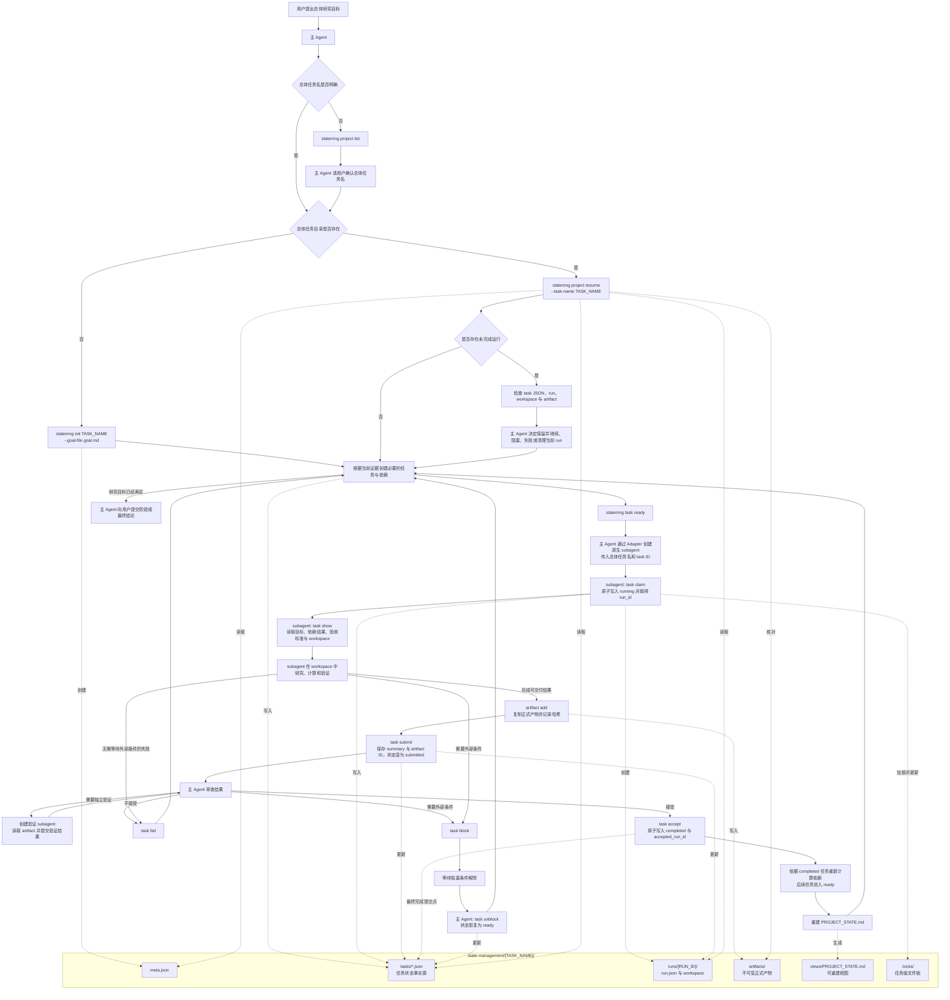

# 跨通用 Agent 的持续研究状态管理基础设施设计方案

---

$\epsilon$-form 构建并非线性流程：一个算例通常需要派发数量众多、相互关联的异步任务，并在不同方法和候选方案之间不断探索、验证和回溯。任务之间的依赖关系必须严格遵循，每次尝试产生的成功经验、失败原因和中间结果也必须妥善保存，供后续任务判断与复用。单个 Markdown 文档适合呈现研究记录，却难以可靠管理并发领取、依赖解锁和状态转换，也难以保证不同会话、不同 Agent 始终使用同一组有效事实。本方案因此以任务目录内的 JSON 数据和受控 CLI 管理任务状态与研究轨迹，以 Markdown 作为可读视图，为持续研究提供可靠的状态管理基础。

**文档版本：** v0.1
**系统定位：** 面向 Codex、Hermes、Claude Code 等通用 Agent 的持续研究基础设施
**核心形态：** 内部 CLI + 按总体任务隔离的文件存储 + 平台适配层
**核心约束：**

1. 用户只与 Codex、Hermes、Claude Code 等主 Agent 交互；
1. CLI 仅作为主 Agent 与 subagent 的内部协作接口，不直接面向用户；
1. 所有 subagent 均由当前宿主 Agent 的原生机制创建；系统本身不启动额外的 Agent 进程；
1. 所有持久化状态和研究产物均位于项目内的 `.state-management/[TASK_NAME]/`；
1. 项目状态独立于任何特定 Agent 的会话。


在 CANON 中，本方案实施后将完全取代当前的 demo 状态机；现有 `workflow.py` 和 `state.json` 不作为兼容或迁移对象。

## 一、项目目标

本系统旨在为不同通用 Agent 提供一套统一的持续研究机制，使其能够：

- 将复杂研究目标拆解为长期任务；
- 使用自身原生 subagent 并行执行子任务；
- **跨会话保存研究进度**；
- **管理任务依赖、阻塞和结果交接**；
- 累积研究证据、决策与产物；
- 保存任务的成功、失败经验及中间结果，供后续任务复用；
- 在更换 Codex、Hermes 或 Claude Code 后继续同一项目。

初版只实现本文明确给出的状态闭环和恢复底线。新的字段、命令和自动化行为只在实际研究测试暴露出明确问题后加入，并同时补充对应测试；不为尚未发生的使用场景预设机制。

## 二、系统的核心模型

整个系统可以概括为：

> 主 Agent 负责规划和调度，原生 subagent 负责执行，CLI 和任务目录内的 JSON 文件负责保存并约束共享状态。

其中：

- 用户只需要与主 Agent 交互；
- 主 Agent 是研究负责人和任务调度者；
- subagent 是临时研究执行者；
- CLI 是所有 Agent 共享的命令集和任务协议；
- `.state-management/[TASK_NAME]/` 内的 JSON、Markdown 和研究产物保存总体任务的长期状态。

## 三、核心设计原则

### 3.1 模型负责研究，程序负责秩序

Agent 负责：

- 理解和拆解研究问题；
- 提出假设、设计验证并分析结果；
- 判断下一步研究方向和操作。


CLI 和底层程序负责：

- 持久化任务状态、运行历史和研究产物；
- 检查任务依赖，保证任务领取与状态转换合法。


系统不能仅依靠提示词要求 Agent “记得更新进度”，关键状态必须通过 CLI 修改。

### 3.2 CLI 不负责创建 subagent

CLI 只管理任务，不直接启动或控制 subagent。

任务分配分为两个层面。

#### 逻辑分配

CLI 记录任务的领取和运行：

```
statemng task claim T-012 \
  --task-name [TASK_NAME]
```

#### 物理分配

主 Agent 使用自身原生能力创建一个 subagent，并把总体任务名和内部任务 ID 告诉它。

因此：

> CLI 管理任务运行，主 Agent 决定创建哪个 subagent 执行任务。

### 3.3 使用统一协议，而不是统一内部实现

不同 Agent 的 subagent 创建方式可能不同：

```
Codex Adapter
Claude Code Adapter
Hermes Adapter
```

但创建后的 subagent 都遵守相同协议：

```
领取任务
→ 读取任务
→ 执行任务
→ 登记产物
→ 提交结果，或报告阻塞与失败
```

结果是否完成验收由主 Agent 决定。平台差异只存在于“如何创建原生 subagent”，不进入核心任务系统。

### 3.4 Markdown 用于阅读，JSON 用于运行

系统在总体任务目录内生成 `views/PROJECT_STATE.md`，供人类和 Agent 快速阅读。运行时状态保存在 JSON 文件中，Markdown 只由 JSON 状态生成或更新。

原则是：

> JSON 是事实源，Markdown 是人类可读投影。

这样既保留透明度，也避免多个 Agent 并发修改同一个进度文档产生冲突。当前版本面向个人科研使用，不引入 SQL。

### 3.5 按总体任务隔离

项目初始化后，所有状态管理产物都必须位于：

```
.state-management/[TASK_NAME]/
```

这里的 `[TASK_NAME]` 指需要长期管理的总体研究任务，内部再拆分为 `T-001`、`T-002` 等任务单元。不同总体任务使用彼此独立的同级目录，不共享可变状态。对于 $\epsilon$-form 项目，总体任务可以对应一个 integral family，目录为 `.state-management/[FAMILY_NAME]/`。

总体任务名称必须本身就是合法目录名，不得包含路径分隔符，也不得为 `.` 或 `..`。CLI 不对名称做隐式改写，从而保证目录名与任务名称一致。

除 `init` 和只读的 `project list` 外，每条命令都必须通过 `--task-name` 精确指定一个总体任务。系统不保存项目级“当前总体任务”，也不根据上下文、提示词或近似名称自动选择。CLI 必须确认 `.state-management/` 位于当前项目内且不是符号链接，并确认总体任务目录是其非符号链接的直接子目录；任何路径逃逸都必须拒绝。解析完成后，本次命令的全部状态读写都必须限制在该总体任务目录内。

## 四、整体架构

初版只有一个本地 CLI 和按总体任务分隔的状态目录。主 Agent 与原生 subagent 通过 CLI 读写明确指定的总体任务；subagent 的创建和研究过程仍由宿主 Agent 负责，不进入状态管理程序。完整工作流如下：



图中的实线表示研究与调度流程，虚线表示 CLI 对持久化文件的读写。除 `init` 和 `project list` 外，图中每次 CLI 调用都显式携带同一个 `--task-name`，图内不再重复标注。任务 JSON 中的 `completed` 是完成事实；Markdown 视图和依赖解锁结果均可由 JSON 重建。

### 4.1、持久化目录设计

项目内部按总体任务维护独立目录：

```
.state-management/
├── [TASK_NAME_1]/
│   ├── meta.json
│   ├── tasks/
│   │   ├── T-001.json
│   │   └── T-002.json
│   ├── runs/
│   │   └── R-001/
│   │       ├── run.json
│   │       └── workspace/
│   ├── artifacts/
│   │   ├── A-001.md
│   │   └── A-002.json
│   ├── .locks/
│   └── views/
│       └── PROJECT_STATE.md
└── [TASK_NAME_2]/
    └── ...
```

其中：

- `meta.json`：总体任务名称、总体目标的 Markdown 原文和 schema 版本；
- `tasks/*.json`：内部任务、依赖、当前状态和运行结果，是任务状态的事实源；
- `runs/[RUN_ID]/run.json`：单次运行的身份、时间和结果记录；
- `artifacts/`：由 `artifact add` 复制并登记的不可变正式研究产物；
- `runs/[RUN_ID]/workspace/`：每次运行的隔离工作目录；
- `.locks/`：CLI 使用的任务级锁文件，不保存研究状态；
- `views/PROJECT_STATE.md`：由 JSON 生成的当前状态摘要。

每个 `[TASK_NAME]` 目录都是完整、自包含的状态单元，可以独立复制、归档或恢复。`.state-management/` 下不设置跨总体任务共享的可变状态。

### 4.2、主 Agent 与 subagent 的协作闭环

初版不预设固定的研究步骤。主 Agent 根据当前证据创建任务和依赖；新的结果可以促使主 Agent 重新规划尚未开展的研究。

一次协作只包含以下步骤：

1. 主 Agent 确定总体任务名；无法唯一确定时，列出已有名称并请用户确认。总体任务不存在时使用总体目标文件初始化，已经存在时直接恢复；随后创建当前确有必要的任务。
1. 主 Agent 查询 `ready` 任务，创建原生 subagent，并传入总体任务名和内部任务 ID。
1. subagent 依次执行 `claim` 和 `show`，在独立 workspace 中研究；重要结果通过 `artifact add` 保存，然后执行 `submit`，或用 `block`、`fail` 说明无法完成。
1. 主 Agent 读取 summary 和 artifact；必要时另行验证。验证 subagent 只提交验证结果，不接受原任务。
1. 主 Agent 确认结果满足当前任务的验收标准后执行 `accept`。只有进入 `completed` 的任务才能满足后续任务的依赖。
1. 任务进入 `blocked` 后，主 Agent 等待并确认阻塞条件已经解除，再执行 `unblock` 将任务恢复为 `ready`，随后重新派发；subagent 不得解除阻塞。
1. 主 Agent 根据已接受的结果决定继续原计划、创建新的后续任务或停止当前路线。

### 4.3、任务状态模型

初版使用以下状态：

```
pending
   │
   │ 依赖满足
   ▼
 ready
   │
   │ subagent claim
   ▼
 running
   │
   │ subagent submit
   ▼
submitted
   │
   │ main Agent accept
   ▼
completed
```

`running` 或 `submitted` 也可以转为 `blocked`；阻塞条件解除后，主 Agent 通过 `unblock` 将任务重新转为 `ready`。运行失败时，`retryable: true` 使任务重新转为 `ready`，否则任务进入 `failed`。

状态含义：

- `pending`：前置依赖尚未完成；
- `ready`：可以被 subagent 领取；
- `running`：已经由某个 subagent 领取；
- `submitted`：subagent 已提交结果，等待主 Agent 验收；
- `completed`：主 Agent 已接受结果，任务正式完成；
- `blocked`：需要用户、主 Agent 或外部条件介入；条件解除后由主 Agent 恢复为 `ready`；
- `failed`：本次执行失败，且没有进入下一次重试；


只有 CLI 可以修改任务状态。

## 五、主要组件

### 5.1 主 Agent

主 Agent 直接使用宿主 Agent，对于当前系统而言，只需要明确其职责，无需单独实现。

主 Agent 是系统中的研究负责人。

主要职责：

- 接收用户目标，读取项目状态并制定研究计划；
- 在总体任务名无法唯一确定时，列出已有名称并请用户确认；
- 创建任务及其依赖，选择可并行推进的任务；
- 创建原生 subagent，并向其传递总体任务名和内部任务 ID；
- 检查 subagent 提交的结果，必要时取得独立验证结果，并决定是否接受；
- 检查执行状态，处理阻塞与失败，并组织结果综合；
- 向用户汇报阶段结果。


主 Agent 不应亲自完成所有子任务，也不应把全部项目状态只保存在自身上下文中。

### 5.2 原生 subagent

subagent 只能由宿主 Agent 的原生机制创建。对于当前系统而言，只需要明确其职责，无需单独实现。

subagent 的职责应尽量单一：

- 调研或理论分析；
- 代码实现或实验执行；
- 数据分析或结果审查；


每个 subagent 启动时只需要得到：

- 总体任务名；
- 内部任务 ID；
- CLI 使用协议。


任务的详细背景由 subagent 自行通过 CLI 获取。subagent 负责提交研究结果，但不能执行 `accept` 或 `unblock`，不能将任务设为 `completed`，也不能自行解除阻塞。

### 5.3 平台 Adapter

Adapter 不负责调度任务，也不负责启动外部进程。

它只描述当前平台如何使用自身原生 subagent。

例如：

```
adapters/
├── codex/
│   └── ADAPTER.md
├── hermes/
│   └── ADAPTER.md
└── claude-code/
    └── ADAPTER.md
```

每个 Adapter 应规定：

1. 如何创建原生 subagent，并传递总体任务名和内部任务 ID；
1. 如何并行执行及限制最大并发数；
1. 如何判断 subagent 已结束，并处理异常退出。
1. 如何确保 `accept` 和 `unblock` 只由主 Agent 调用，并禁止 subagent 使用对应 tools。


Adapter 应尽量薄，不保存任何项目状态。

### 5.4 State Management CLI

CLI 是系统的内部控制接口。

CLI 供主 Agent 和原生 subagent 使用，不直接面向用户。命令名称统一为 `statemng`，默认返回 JSON；其中 `ok` 只表示本次命令是否执行成功，不表示任务是否完成。任务状态只能通过 CLI 修改。

## 六、CLI 命令设计

初版只实现以下命令。

`statemng init` 以调用时的工作目录作为项目根目录。其他命令从调用位置向上定位最近的项目级 `.state-management/`；找不到时停止。CLI 只利用调用位置确定所属项目，不改变主 Agent 或 subagent 的工作目录。

除 `init` 和 `project list` 外，所有命令都必须显式提供 `--task-name [TASK_NAME]`。缺少该参数时返回 `TASK_NAME_REQUIRED`；名称不存在时返回 `TASK_NOT_FOUND`。两种情况都不得修改文件。任务名成功解析后，所有返回均包含实际使用的 `task_name`。

### 6.1 初始化项目

```
statemng init [TASK_NAME] \
  --goal-file goal.md
```

职责：

- 创建 `.state-management/[TASK_NAME]/`；
- 初始化 JSON 状态文件、artifact 和运行目录；
- 读取总体目标文件，将其 Markdown 原文写入 `meta.json` 的 `goal` 字段；
- 写入 schema 版本及总体任务名称；
- 生成初始 Markdown 状态视图。


`--goal-file` 必须指向存在、非空且采用 UTF-8 编码的 Markdown 文件。该文件只作为初始化输入；CLI 不保存其路径，也不额外复制该文件。初始化完成后，`meta.json` 中的 `goal` 是总体目标的事实源，外部文件的后续修改不影响已初始化的总体任务。初版不提供修改总体目标的命令。

若总体目标文件无效，或者同名总体任务目录已经存在，命令必须停止且不得修改文件。初始化不改变主 Agent 的工作目录。


返回：

```
{
  "ok": true,
  "task_name": "[TASK_NAME]",
  "task_root": "/path/to/project/.state-management/[TASK_NAME]",
  "schema_version": 1
}
```

### 6.2 列出和恢复总体任务

```
statemng project list --json
```

该命令只列出当前项目已有的总体任务名，不读取或修改各总体任务的内部状态：

```
{
  "ok": true,
  "task_names": ["TASK-A", "TASK-B"]
}
```

`.state-management/` 尚不存在时，该命令返回空列表而不是报错。

用户已经明确给出总体任务名时，主 Agent 直接使用；用户明确要求以该名称新建时，主 Agent 准备总体目标文件后执行 `init`。没有现有总体任务且用户未指定名称时，主 Agent 提出名称并请用户确认；名称未明确且存在多个总体任务，或者准备恢复的名称不存在时，主 Agent 应将已有名称交给用户确认。不得自行猜测、改名或创建新任务。CLI 不模拟用户确认，只负责在任务名缺失或无效时停止。

```
statemng project resume \
  --task-name [TASK_NAME] \
  --json
```

供主 Agent 每次新会话开始时调用。

返回内容应包括：

- 项目目标；
- 各任务的当前状态；
- 已提交的结果和未完成运行。


该命令应返回压缩后的项目状态，而不是整个历史记录。

### 6.3 创建任务

```
statemng task create \
  --task-name [TASK_NAME] \
  --title "调查相关研究工作" \
  --description-file task.json \
  --depends-on T-001,T-002 \
  --json
```

`task.json` 的格式为：

```json
{
  "objective": "[目标]",
  "background": "[背景，如：前面已经完成了xxx，...]",
  "acceptance_criteria": [
    "[酌情制定验收标准]"
  ],
  "required_skills": [
    "methods/libra/SKILL.md"
  ]
}
```

其中，`objective` 必须是非空字符串；`background` 必须是字符串，没有额外背景时可以为空；`acceptance_criteria` 必须是至少包含一个非空字符串的数组。`required_skills` 是可选字符串数组；每项必须是仓库内实际存在的相对 `SKILL.md` 路径，不得使用绝对路径、`..`、其他文件名、缺失文件或重复路径。省略该字段的旧任务描述保持兼容。不得包含其他字段。该文件只作为创建任务的输入；CLI 将这些字段写入任务 JSON，不保存原文件路径，后续状态也不依赖原描述文件。

设计要求：

- 自动生成稳定任务 ID；
- 校验并保存任务目标、背景、依赖、验收标准和可选 required skills；
- JSON 描述文件无效时停止且不得创建任务。


返回：

```
{
  "ok": true,
  "task_name": "[TASK_NAME]",
  "task_id": "T-012",
  "status": "pending",
  "dependencies": ["T-001", "T-002"],
  "required_skills": ["methods/libra/SKILL.md"]
}
```

依赖全部完成后，系统自动将任务转为 `ready`。

### 6.4 查询可执行任务

```
statemng task ready \
  --task-name [TASK_NAME] \
  --json
```

供主 Agent 判断应该创建哪些 subagent。

返回内容应保持精简：

```
{
  "task_name": "[TASK_NAME]",
  "tasks": [
    {
      "task_id": "T-012",
      "title": "调查相关研究工作"
    }
  ]
}
```

### 6.5 领取任务

> **备忘（当前版本不实现）：** 后续可以考虑在 `claim` 阶段设置并发限制：当当前总体任务中处于 `running` 的任务达到上限时，`statemng` 拒绝新的领取请求，从而间接限制同时进入执行阶段的 subagent 数量。该机制不能限制宿主已经创建的 subagent 总数，创建侧的并发仍由主 Agent 和 Adapter 控制。若以后实施，还需要单独设计并发判断的原子性、领取被拒绝后的处理，以及异常退出遗留 `running` 状态时的额度恢复；当前版本不定义相关参数和协议。

```
statemng task claim T-012 \
  --task-name [TASK_NAME] \
  --json
```

该命令通常由 subagent 启动后首先调用。

职责：

- 原子检查任务是否为 `ready`；
- 防止多个 subagent 重复领取；
- 将任务变为 `running`；
- 创建唯一 `run_id`；
- 记录领取时间。

返回：

```
{
  "ok": true,
  "task_name": "[TASK_NAME]",
  "task_id": "T-012",
  "run_id": "R-048",
  "status": "running"
}
```

若任务已被领取：

```
{
  "ok": false,
  "task_name": "[TASK_NAME]",
  "error": "TASK_ALREADY_CLAIMED"
}
```

### 6.6 读取任务

```
statemng task show T-012 \
  --task-name [TASK_NAME] \
  --run-id R-048 \
  --json
```

返回：

- 任务目标、背景和验收标准；
- 研究前必须完整读取的 required skills（若有）；
- 前置任务结果及相关 artifact；
- 当前运行的工作目录。

这样主 Agent 不需要在创建 subagent 时复制完整上下文。

subagent 在 `claim` 和 `show` 之后、开始研究之前，必须按返回顺序完整读取每个 `required_skills` 路径；该字段缺失或为空时不增加额外 Skill。

### 6.7 登记产物

```
statemng artifact add \
  --task-name [TASK_NAME] \
  --task T-012 \
  --run-id R-048 \
  --path runs/R-048/workspace/literature-review.md \
  --json
```

职责：

- 验证文件存在；
- 计算内容哈希；
- 保存来源任务和运行 ID；
- 将文件复制到统一 artifact 目录；
- 登记后的正式 artifact 不再修改；
- 返回 artifact ID。


返回：

```
{
  "ok": true,
  "task_name": "[TASK_NAME]",
  "artifact_id": "A-031",
  "stored_path": ".state-management/[TASK_NAME]/artifacts/A-031.md"
}
```

任务的重要结果不能只存在于 subagent 的聊天回复中。

### 6.8 提交任务结果

```
statemng task submit T-012 \
  --task-name [TASK_NAME] \
  --run-id R-048 \
  --summary-file runs/R-048/workspace/summary.md \
  --artifact A-031 \
  --json
```

职责：

- 检查调用者是否持有当前任务；
- 检查命令中声明的 artifact 已经由当前任务和运行登记；
- 保存本次运行的 summary 和 artifact ID；
- 将任务设为 `submitted`，等待主 Agent 验收；
- 不将任务设为 `completed`，也不解锁后续任务。


返回：

```
{
  "ok": true,
  "task_name": "[TASK_NAME]",
  "status": "submitted"
}
```

### 6.9 接受任务结果

```
statemng task accept T-012 \
  --task-name [TASK_NAME] \
  --run-id R-048 \
  --json
```

该命令只由主 Agent 调用。若需要独立验证，主 Agent 可以创建验证 subagent；验证 subagent 只提交验证结果，是否接受原任务仍由主 Agent 决定。

职责：

- 检查任务是否为 `submitted`，且 `run_id` 对应当前提交；
- 检查 summary、任务的三个描述字段和本次提交声明的 artifact 是否完整，artifact 是否存在且哈希一致；
- 由主 Agent 根据 `acceptance_criteria`、研究结果和必要的验证结果判断是否通过验收；CLI 只检查验收字段的结构，不判断科研结果是否满足验收标准；
- 在 summary、artifact 和运行记录均已持久化后，最后原子替换 `tasks/T-012.json`，一次写入 `status: completed`、`accepted_run_id`、artifact ID 和完成时间；
- 将这次任务 JSON 原子替换作为任务正式完成的唯一提交点；
- 提交成功后解锁依赖该任务的后续任务，并更新 Markdown 视图。


若最终任务 JSON 已提交，而后续解锁或 Markdown 更新被中断，`project resume` 根据依赖关系重新计算 `ready` 状态并重建视图。


返回：

```
{
  "ok": true,
  "task_name": "[TASK_NAME]",
  "status": "completed",
  "unlocked_tasks": ["T-015"]
}
```

### 6.10 阻塞任务

```
statemng task block T-012 \
  --task-name [TASK_NAME] \
  --run-id R-048 \
  --reason-file blocker.md \
  --json
```

当任务必须等待用户、主 Agent 或外部条件才能继续时，将任务设为 `blocked`，并在 reason 文件中写明具体阻塞条件。阻塞不同于失败，已经形成的中间产物必须保留。

### 6.11 解除任务阻塞

```
statemng task unblock T-012 \
  --task-name [TASK_NAME] \
  --run-id R-048 \
  --json
```

该命令只由主 Agent 在确认阻塞条件已经解除后调用。CLI 必须在任务锁内确认任务当前为 `blocked`，并确认给出的 `run_id` 与该任务被阻塞的当前运行一致；条件不满足时停止且不得修改状态。

命令成功后：

- 将任务原子更新为 `ready`，允许主 Agent 重新派发；
- 从任务当前状态中移除旧 `run_id`、阻塞原因以及旧 run 的 `summary` 和 `artifact_id`；
- 保留原 run 的 `blocked` 状态、阻塞原因、workspace 和已有 artifact，作为本次阻塞的完整记录；
- 后续 `claim` 创建新的 `run_id`，不得复用原运行。
- 更新 Markdown 状态视图。

返回：

```
{
  "ok": true,
  "task_name": "[TASK_NAME]",
  "task_id": "T-012",
  "run_id": "R-048",
  "status": "ready"
}
```

subagent 不得执行 `unblock`。主 Agent 不能仅因希望重试而解除阻塞；如果阻塞条件仍未消失，应继续保留 `blocked` 状态。

### 6.12 标记任务失败

```
statemng task fail T-012 \
  --task-name [TASK_NAME] \
  --run-id R-048 \
  --reason-file failure.md \
  --retryable true \
  --json
```

失败信息应包括：

- 失败原因；
- 已尝试的方法和保留下来的中间结果。


`retryable: true` 表示结束本次 run，并将任务重新设为 `ready`；否则任务进入 `failed`。系统不自动重试，是否再次派发仍由主 Agent 决定。

### 6.13 查询状态

```
statemng task status T-012 \
  --task-name [TASK_NAME] \
  --json
```

或：

```
statemng task list \
  --task-name [TASK_NAME] \
  --status running,blocked \
  --json
```

主要供主 Agent 使用。

返回：

- 当前状态和 run ID；
- 已提交的 summary 和 artifact。

### 6.14 读取研究产物

```
statemng artifact show A-031 \
  --task-name [TASK_NAME] \
  --json
```

或：

```
statemng artifact list \
  --task-name [TASK_NAME] \
  --task T-012 \
  --json
```

主 Agent 或综合 subagent 通过 artifact 获取结果，而不是依赖原始 subagent 会话仍然存在。

### 6.15 项目校验

```
statemng doctor \
  --task-name [TASK_NAME] \
  --json
```

用于检测：

- 无法解析或版本不兼容的 JSON；
- 无效或循环的任务依赖；
- 任务与当前 run 不一致；
- 丢失或哈希不一致的 artifact；
- 断电后遗留的临时文件和未完成运行。

### 6.16 断电恢复

总体任务恢复时，只有任务 JSON 已经原子写入 `status: completed` 和 `accepted_run_id`，任务才视为正式完成。`statemng project resume --task-name [TASK_NAME] --json` 应列出所有关联任务尚未正式完成的运行及其目录，但不自动删除文件，也不自动重试。

该命令可以依据已提交的任务依赖确定性地恢复 `pending` 到 `ready` 的转换并重建 Markdown 视图；是否保留未成功运行的文件则必须由主 Agent 判断。

主 Agent 逐项检查这些运行的任务状态、run 记录、workspace 和 artifact，并决定：

- 结果完整且可验证：保留结果，补交 `submit`，复核后执行 `accept`；
- 中间结果仍有价值：保留相应文件，将任务设为 `blocked`，或用可重试的 `fail` 重新设为 `ready`；
- 文件无效、重复或已不再需要：只清理该运行的目录，再重新派发或结束任务。

对于已经处于 `blocked` 的任务，`project resume` 只报告其状态和阻塞原因，不自动解除阻塞。主 Agent 确认条件已经解除后，使用 `task unblock` 将任务恢复为 `ready`。


清理由主 Agent 使用宿主环境的文件操作直接执行，不增加 `statemng cleanup` 或 `statemng recover` 命令。若需要改变任务状态，主 Agent 先通过现有的 `submit`、`accept`、`block` 或 `fail` 命令记录决定，再直接清理选定文件。清理范围必须限制在当前 `.state-management/[TASK_NAME]/runs/[RUN_ID]/`；已登记 artifact、已接受的运行和其他总体任务目录不得删除。无法判断时默认保留。对于 $\epsilon$-form 任务，清理前尤其应检查耗时的符号计算、候选变换和验证残差是否仍可复用。

## 七、可靠性要求

### 7.1 原子任务领取

两个 subagent 同时领取同一任务时，只允许一个成功。CLI 应对稳定的 `.locks/T-xxx.lock` 加排他锁，在锁内重新读取和校验 `tasks/T-xxx.json`，并通过同目录临时文件、落盘和原子替换提交新状态。进程退出或断电后锁由操作系统释放。

### 7.2 任务完成提交点与幂等操作

`task accept` 必须先确认 summary、artifact 和运行记录均已持久化，再在任务锁内通过同目录临时文件、落盘和原子替换将任务 JSON 设为 `completed`。这次任务 JSON 原子替换是任务正式完成的唯一提交点；后续依赖解锁和 Markdown 更新即使中断，也可以恢复重建。

同一个 `run_id` 重复提交相同 artifact 时，不应产生无限重复记录；对已经接受的同一 `run_id` 重复执行 `task accept`，应返回已有完成状态，不得再次产生完成记录。

### 7.3 运行身份验证

提交、阻塞、解除阻塞或标记本次运行失败时必须提供当前 `run_id`，CLI 必须验证它与任务当前运行一致。只有主 Agent 可以接受提交并将任务设为 `completed`，也只有主 Agent 可以解除阻塞。

### 7.4 非法退出处理

若 subagent 已退出但任务仍处于 `running`：

- 主 Agent 应检查状态；
- 通过可重试的 `fail` 将任务设为 `ready`，或将任务设为 `blocked`；
- 保留已有 artifact 和 workspace。


由于 CLI 不直接管理 subagent 进程，异常退出检测主要由主 Agent 和 Adapter 负责；断电后的判断和清理遵循 6.16。

### 7.5 工作目录隔离

每个运行使用独立 workspace：

```
.state-management/[TASK_NAME]/runs/R-001/workspace/
```

多个 subagent 不应直接同时修改同一份关键文件。

正式结果通过 artifact 机制汇合。
