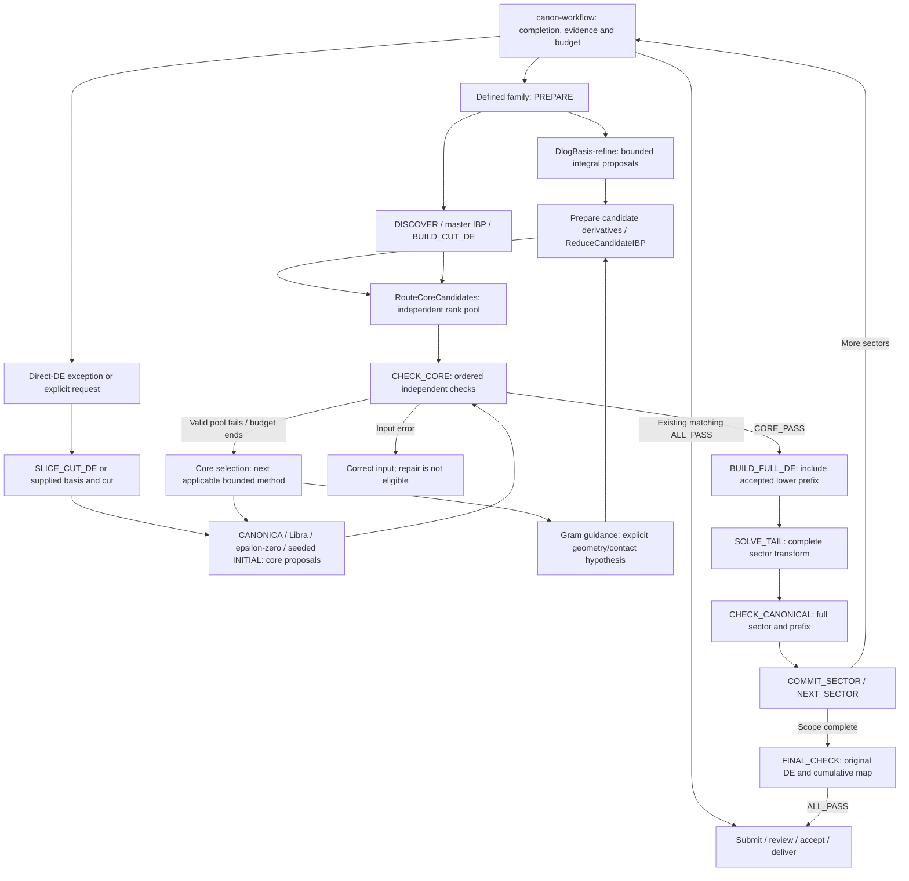
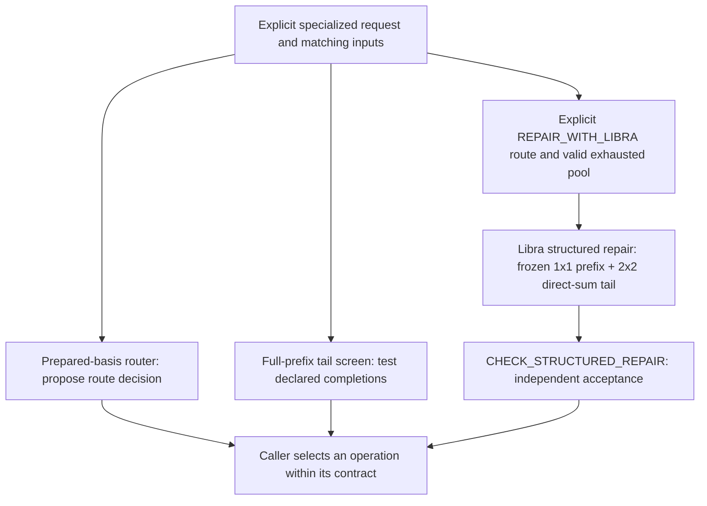

# Method cards: capabilities and I/O

Start at [the workflow entry](../skills/canon-workflow/SKILL.md) to choose the
next operation. This page catalogs method capabilities and their contracts;
it does not define another routing order. The
[workflow guide](../docs/agent-workflow.md) describes the complete study, and
[INTERFACES.md](../INTERFACES.md) defines script envelopes and scientific I/O.

For integral-basis discovery from a defined family, choose from its geometry
and current evidence. Small dot/normalization bundles, Gram constructions and
bounded DlogBasis-refine searches share the same downstream acceptance gates;
none is a prerequisite for every sector. The workflow entry also describes
direct-DE choices. When DlogBasis is selected, package loading or
`CreateDlogFamily` alone is preparation, not a `DlogBasisSearch` attempt.
Retain the bounds and results that motivate later choices, and reuse accepted
sectors.

## Routing boundary

A card describes one bounded operation on declared scientific inputs, not all
capabilities of a package. The workflow selects the unfinished operation; its
step skill selects an applicable card. The card returns an artifact or a precise
limit to that caller. It does not schedule workers, accept tasks, or silently
switch to another provider. A documented finite sequence such as Libra's
`Fuchsify` and `FactorOut` may implement one operation.

Read each card's role, activation conditions, input scope, permitted changes,
attempt bounds, and output/checker together. Cards are alternatives only when
those contracts fit the same unresolved operation. A passing provider diagnostic
does not replace the named independent checker. A screen/checker can issue a
scoped check result; a router only proposes an action. The
[template](method-card-template/SKILL.md) describes these roles.

The groups below describe workflow availability, not quality or package-wide
support. Main methods remain subject to core-selection rules. Specialized cards
require their explicitly requested contracts; they are not later levels of an
automatic fallback chain. Gram is instruction-based construction, and the
template contains no implemented scientific method.

| Package or operation | Current role and activation | Boundary with the main workflow |
|---|---|---|
| CANONICA core | Main direct-DE candidate provider | Current cut only; `core_candidates` go to `CHECK_CORE` |
| CANONICA tail backend | Internal implementation of `SOLVE_TAIL`, not a second mode of the core card | Full cumulative transform goes to `CHECK_CANONICAL`; configuration follows the tail skill |
| Libra core | Main direct-DE candidate provider | Single-variable rational cut; optional bounded normalization and automatic or explicit dependent-row strategy, then `CHECK_CORE` |
| Libra structured repair | Specialized opt-in transformation provider | Frozen `1x1` prefix plus direct-sum `2x2` tail; `CHECK_STRUCTURED_REPAIR` |
| INITIAL seeded core | Main direct-DE candidate provider with explicit normalized seeds | Rational one-variable cut, declared alphabet and finite derivative allocation; `CHECK_CORE` |
| Prepared-basis router / tail screen | Specialized opt-in decision / independent screening | Separate contracts; neither calls a solver or authorizes unrestricted repair |

Multivariable Libra automation, multivariable or elliptic INITIAL workflows,
and automatic UT seed/normalization discovery are not implemented. Upstream package
capabilities alone do not extend an adapter's contract.

## Main methods

The diagram shows scientific artifact handoffs. The coordinator selects the
next unfinished operation using the workflow entry; arrows do not imply an
automatic scheduler. A defined-family search starts with the bounded integral
proposal. DE preparation and candidate preparation use their own inputs; the
proposal does not require the cut DE or candidate derivative `exact_strategy`.
Direct-DE cards require the core-selection exception or an explicit request.



CANONICA's core card configures one recursive or directed-block core attempt.
Libra can explicitly prepend bounded integer-offset normalization. INITIAL
consumes a small explicitly normalized seed set and returns the same core
artifact. These are choices inside SEARCH_CORE. The CANONICA
backend used internally by `SOLVE_TAIL` has a separate option contract. A
provider returns provisional proposals; the named independent gate establishes
scientific acceptance. A passing core alone does not certify a full sector.

| Card | Trigger and operation | Required input | Output and next gate |
|---|---|---|---|
| [Dot/normalization proposal](../skills/canon-search-core/SKILL.md#2-prepare-and-execute-the-integral-route-in-order) | A small geometry-motivated integral bundle | Exact index order, selected dots, prefactors and epsilon normalization with finite bounds | Manually encoded `integral_candidates`; same IBP/core/full-prefix gates. No standalone runner |
| [DlogBasis-refine](dlogbasis/SKILL.md) | Defined-family integral proposals; `PROPOSE_INTEGRAL_CANDIDATES` | `prepared_family`, family/sector identities, dimension and power-counting policies, budget, normalization, installed tool options | `integral_candidates`; candidate IBP bridge, `RouteCoreCandidates.wls`, then `CHECK_CORE` |
| [Gram/off-cut guidance](gram/SKILL.md) | Supported Gram/numerator construction, cut/IBP rank mismatch, dimensional continuation, or off-cut correction | Actual family geometry, bounded numerator/contact hypothesis, and existing failure report when available | Manually constructed `integral_candidates`; same IBP/core/full-prefix gates. No standalone runner |
| [CANONICA](canonica/SKILL.md) | Rational core transformation in one or more variables; `SEARCH_CORE` | `sector_basis`, `sector_cut_de`, package entry or Wolfram installation | `core_candidates`; `CHECK_CORE` |
| [Libra](libra/SKILL.md) | Small rational one-variable core; `SEARCH_CORE` | `sector_basis`, `sector_cut_de`, package options; optional explicit dependent-row hierarchy | `core_candidates`; `CHECK_CORE` |
| [INITIAL](initial/SKILL.md) | One or a few normalized UT seeds for a rational one-variable core; `SEARCH_CORE` at `methods/initial/run.wls` | `sector_basis`, `sector_cut_de`, seed request, full seed rows or existing IBP bridge, normalization evidence, alphabet and component/budget options | `core_candidates`; `CHECK_CORE` |
| [Epsilon-zero polynomial](epsilon-zero/SKILL.md) | Rational core regular at epsilon zero, with the card's finite polynomial ansatz; `SEARCH_CORE` | `sector_cut_de`, optional `declared_alphabet` and reconstruction prime | `core_candidates`; `CHECK_CORE` |
| [Residue balances](residue-balance/SKILL.md) | One essential rational variable, optionally after exact homogeneous-scale separation; `DIAGNOSE_CORE`, `SEARCH_CORE` | `sector_basis`, `sector_cut_de`, optional finite bounds | Provisional `core_diagnosis` or `core_candidates`; candidates require `CHECK_CORE` |

Every successful proposal is provisional. `CHECK_CORE` verifies the current
cut's invertibility, exact gauge relation, flatness, and epsilon factorization.
A passing cut does not establish full-prefix canonical form: continue through
`BUILD_FULL_DE`, `SOLVE_TAIL`, and `CHECK_CANONICAL`; finish the stated scope
with `FINAL_CHECK`. Use the corresponding [workflow skills](../skills/) for
these operations. General tail solving uses `mma/SolveTail.wls` and does not
require the optional screen or Libra repair below.

## Specialized opt-in cards

These cards apply only when a task explicitly requests their contracts.
They are not prerequisites or automatic fallbacks for the main methods.



The router does not emit `REPAIR_WITH_LIBRA`, and screen exhaustion alone does
not invoke repair. These scoped results do not replace `CHECK_CANONICAL` or
`FINAL_CHECK` for a full-family claim. The method-card template is a development
scaffold and has no runtime position in either diagram.

| Card | Prerequisites and operation | Output and next action |
|---|---|---|
| [Prepared-basis router](route-prepared-basis/SKILL.md) | Valid `prepared_basis`; `ROUTE_PREPARED_BASIS` | Provisional `route_decision`; invoke the selected operation within its contract. It does not execute a provider or select `REPAIR_WITH_LIBRA` |
| [Full-prefix tail screen](full-prefix-tail-screen/SKILL.md) | Exact rational one-variable pool, explicit alphabet, frozen accepted lower prefix, one completion per core ID; `SCREEN_TAIL` | `TAIL_SCREEN_PASS` or exact bounded-pool results; never invokes repair. Its exhaustion-based repair eligibility belongs only to this contract |
| [Libra structured repair](libra-structured-repair/SKILL.md) | Explicit `REPAIR_WITH_LIBRA` route and exhausted declared pool; exact one-variable direct sum of accepted `1x1` prefix and `2x2` tail, no mixing | Provisional `repair_candidate`; independent `CheckStructuredRepair.wls` |
| [MethodCard template](method-card-template/SKILL.md) | Implementing a new bounded role with one declared stage | Interface template only; no scientific method or runnable provider |

The INITIAL core provider does not discover or rank UT seeds automatically.
The Libra structured repair is confined to its
direct-sum tail; it is not the general off-diagonal tail backend. The screen's
`CANDIDATE_BUDGET_EXHAUSTED` means untested candidates remain; its
`CANDIDATE_POOL_EXHAUSTED` requires complete coverage and failure of every
declared completion. Neither result establishes that the family has no
canonical or UT basis.

## Official reference validation and compatibility

INITIAL's old fixed 26-element ladder flow lives in
[the reference validation example](../methods/initial/reference/README.md).
It is a regression and normalization benchmark, outside the selectable method
catalog. The active INITIAL core contract above does not depend on this fixture.

The existing `PROVIDE_UT_EVIDENCE` address `methods/initial/run.wls` and
`CHECK_UT_EVIDENCE` address `mma/CheckUTEvidence.wls` remain compatible. They
delegate to the example's provider/checker only for their explicit steps, preserve
`ut_evidence`/`verified_ut_evidence` schemas, and report
`interface.lifecycle="compatibility"`, fixed verification scope and
`core_selection_eligible=false`. `VERIFIED_EVIDENCE` certifies agreement with
the fixed official normalized reference; it is neither a general UT verifier nor
a core/full-prefix acceptance or automatic route change. A reference mismatch
can coexist with a valid transformation in another constant gauge or order.

For ordinary INITIAL calls use `SEARCH_CORE` at `methods/initial/run.wls` and
the [complete seed contract](initial-core/SKILL.md). The entry chooses solely by
the declared step; a failed core attempt never falls back to official validation.

## Artifact conventions and examples

Scientific artifacts are Wolfram Language Associations written with `Put`
and read with `Get`. JSON carries descriptors. Keep exact IDs, schemas, basis
orders, variables, regulator, and coefficient domains from the declared input.
The following existing fixtures illustrate the shapes; they are examples of
the interfaces, not scientific evidence for another family.

| Artifact | Shape/example and essential constraint |
|---|---|
| `integral_candidates` | [Request](../interfaces/integral-candidate-input.example.json), [artifact](../tests/fixtures/method_cards/integral-candidates.wl), and [contract](../INTERFACES.md#integral-candidatesv1); stable IDs, exact definitions, dimension/power bounds, normalization, budget, pool state, evidence, and provenance |
| `sector_basis` | [Example](../tests/fixtures/method_cards/sector-basis.wl); basis exactly matches the cut basis |
| `sector_cut_de` | [Example](../tests/fixtures/method_cards/sector-cut-de.wl); square matrices in declared variable order, with `D[basis, variable[[i]]] == matrices[[i]].basis` |
| `core_candidates` | [Contract and complete test fixture](../INTERFACES.md#core-candidatesv1); stable candidate IDs, explicit pool counts, exact transformations, transformed matrices, and source rows. The [smaller fixture](../tests/fixtures/method_cards/tail-core-candidates.wl) is screen-only |
| `libra-dependent-row-hierarchy/v1` | [Example](../tests/fixtures/method_cards/libra-dependent-row-hierarchy.wl) and [card](libra/SKILL.md); `n×n` binary mask in cut order, unit diagonal, cycles permitted, exact identity/order, source hash, `mapped_sectors -> False`, and positive `max_mask_nonzeros` |
| `initial-seed-request/v1` and `initial-seed-rows/v1` | [Seeded core card](initial-core/SKILL.md); exact source/order, explicit seed IDs and derivative allocation, declared letters, full rows and established normalization evidence with source hashes |
| `canonica-rational-ansatz/v1` | [Core card](canonica/SKILL.md) for T or [tail skill](../skills/canon-solve-tail/SKILL.md) for D; hashed finite rational terms, source identity and byte hash, variables and exact block scope |
| `canonica-tail-checkpoint/v1` | [Tail skill](../skills/canon-solve-tail/SKILL.md); hashed partial D bound to source, selected candidate, cumulative map, active partition and CANONICA entry; no independent acceptance until completion |
| `prepared_basis` | [Example](../tests/fixtures/method_cards/prepared-basis-refine.wl) and [router](route-prepared-basis/SKILL.md); consistent identities, accepted lower prefix when present, unique consecutive ranks, one selected candidate, and consistent quality/search history |
| `accepted_prefix` | [Production example](../tests/fixtures/final-check/accepted-prefix.wl); complete cumulative source/basis relation, transformation, matrices, and alphabet. The [screen example](../tests/fixtures/method_cards/tail-accepted-prefix.wl) illustrates the smaller frozen-prefix input |
| `full_prefix_candidates` | [Example](../tests/fixtures/method_cards/tail-full-prefix-candidates.wl); lower basis before current basis, source matrices, declared alphabet, and candidate-specific full transformations |
| `libra-structured-repair-input/v1` | [Example](../tests/fixtures/method_cards/structured-repair-input.wl) and [card](libra-structured-repair/SKILL.md); exact identity/order/domain/convention, frozen prefix, forbidden blocks, localized target, and pool-exhaustion evidence |
| `ut_evidence` | [Fixed request](../tests/fixtures/method_cards/initial-evidence-input.json) and [validation example](../methods/initial/reference/README.md); compatibility scope and hashes, A/T/B, `verification_status -> "AWAITING_INDEPENDENT_VERIFICATION"` |

Core transformations use `old_basis = transformation . new_basis`. For each
variable and `T = transformation`,

```wl
Bi == Inverse[T].(Ai.T - D[T, variable])
```

For reduced integral rows, `new_basis = R.old_basis` and `T = Inverse[R]`.
The core columns follow resident `sector_basis["basis"]` order. Proper-subsector
coefficients stay out of the cut quotient but remain in `full_new_basis_rows`
against the full `source_basis`. Never discard them before `BUILD_FULL_DE`.
The current router chooses an independent row basis and single-row exchanges,
not every subset; submit a complete ordered bundle when several rows must
change together. Candidate IDs stay stable after pool reordering; list indices
describe only that run's attempt order.

`BUILD_CUT_DE` records matrix row boundaries as `{{1,n}}`; `proper_subsectors`
separately lists the strict subsectors discarded by the quotient.
`BUILD_FULL_DE` exposes `canon-neu/full-prefix-candidates/v1` through its
`full_sector_de` descriptor. The optional screen freezes the lower prefix;
general `SOLVE_TAIL` may update lower epsilon normalization and returns the
complete cumulative map. Preserve that map for the subsequent canonical and
final checks.

## Result meanings

All results use `canon-neu/script-result/v1`.

| Status | Meaning |
|---|---|
| `ERROR` | Input, environment, tool, or computation failed; no mathematical conclusion |
| `INCONCLUSIVE` | The input is outside the method's scope or its bounded domain is exhausted |
| `PROVISIONAL` | A proposed integral, transformation, route, or evidence item awaits its next gate |
| `FAIL` | An independent checker rejected a scientific claim within its stated scope |
| `PASS` | The named step succeeded; only its stated checks are established |

For example, `TAIL_READY` reports a completed tail proposal; CHECK_CANONICAL
and FINAL_CHECK still decide canonical acceptance.

Integral generation returns `PROVISIONAL/INTEGRAL_CANDIDATES`; transformation
providers, including seeded INITIAL, return `PROVISIONAL/CANDIDATE_TRANSFORMATION`; the official reference compatibility provider returns
`PROVISIONAL/EVIDENCE_AWAITING_VERIFICATION`. Providers do not publish `PASS`
or mathematical `FAIL`. `OUT_OF_SCOPE` and `METHOD_EXHAUSTED` are inconclusive;
errors need specific codes, not `ERROR/ERROR`. Provider checks and process exit
code zero never replace independent scientific gates.

`DIAGNOSE_CORE` returns `PROVISIONAL/CORE_DIAGNOSIS` for structural applicability,
with `nonexistence_proved: false`. Epsilon-zero residues constrain only gauges
with the required specialization properties; they cannot alone exclude the
default epsilon-meromorphic class. See [obstruction scope](../skills/canon-search-core/SKILL.md#scope-of-an-obstruction).

Finite-cut residue rank, d-dimensional IBP rank, full epsilon form,
dlog/alphabet membership, and UT normalization are separate evidence layers.
Epsilon form alone cannot fix kinematics-independent normalization, including
epsilon-dependent factors. A UT claim needs applicable integrand dlog/LS,
independent INITIAL/Picard–Fuchs evidence, or weight-graded boundary/lower-sector
information. Bare numerical agreement is insufficient.

## Invocation and dependency provenance

Each runnable card takes an input JSON and a new output directory in the
assigned workspace. Invoke it through `python3 run_step.py INPUT.json OUTPUT_DIR`
with the task's `--components` selection. Default `SEARCH_CORE` cards additionally
use `--method canonica`, `libra`, `initial`, `epsilon-zero` or `residue-balance`. Other cards have distinct step
names. Use `--describe` to find the selected implementation and its instructions;
a replacement's method details supersede this catalog's defaults. The
[component contract](../docs/components.md) describes packaging and composition.
Keep tool installations read-only. Relative artifact/package paths resolve
from the declaring JSON; see [external dependencies](../external/README.md).
Use supplied executable paths and resource budgets, not a personal layout.

Generic external-package cards resolve `method_options.package_entry` or use
the documented Wolfram `$Path` lookup. INITIAL's active seeded-core and official
compatibility interfaces require explicit component paths. Record actual entry, SHA-256, resolution
source, options, diagnostics, runtime, and available tool identity. DlogBasis-refine
also needs its declared dependency revision; CANON's outer Git HEAD is not that
revision. Bundled source does not prove native dependencies are installed.

CANONICA loads and checks its package before evaluating the cut DE to avoid
the ``Global`eps``/``CANONICA`eps::shdw`` load-order issue. Thus a specific
`ERROR/TOOL_*` precedes `ERROR/INVALID_DIFFERENTIAL_SYSTEM` when both fail.
Keep this error classification distinct from scientific fallback.
